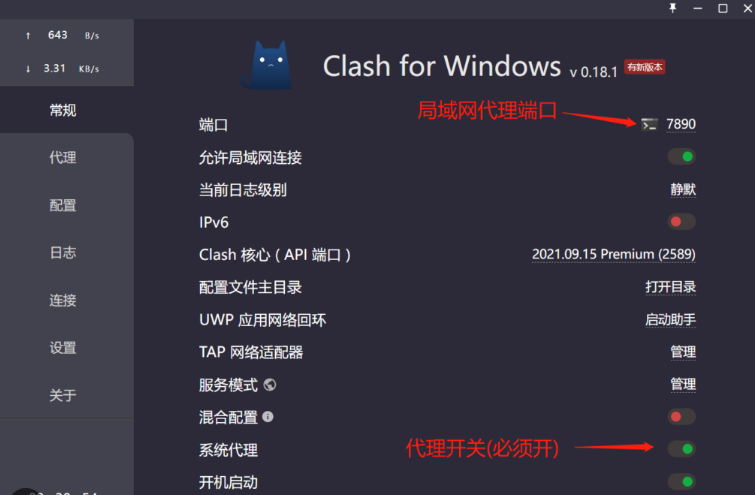

<h2>clashclash机场节点apk 电视安装下载在哪里可以找到以及如何保证版本兼容性？</h2>
<h3>针对智能电视端的 c机场免费节点订阅lashapk 电视安装下载版本适配性分析</h3>

在进行智能电视端的网络环境部署时，寻找合适的软件版本是首要任务。由于电视系统（如 Android TV、HarmonyOS 或各种厂商定制系统）的底层架构与手机端存在显著差异，直接使用手机版的 APK 文件往往会导致 UI 适配不良或遥控器操作失效。在搜索 <strong>clashapk 电视安装下载</strong> 时，用户应重点关注支持 Leanback 架构的版本。这种架构专门为大屏设备设计，能够确保用户仅通过红外或蓝牙遥控器即可完成节点的切换与配置文件的更新。

硬件架构的匹配同样决定了安装的成败。目前市面上主流的电视盒子与智能电视多采用 ARMv7 (armeabi-v7a) 或 ARMv8 (arm64-v8a) 指令集。如果下载了不匹配的架构包，系统会弹出“解析包错误”或安装后直接闪退。对于大部分中低端电视，优先选择 armeabi-v7a 版本具有更高的兼容性。此外，电视端的内存管理机制较为严格，建议在安装后进入系统设置，为该应用开启“允许后台运行”权限，以防止在观看高清视频流时后台进程被系统强制杀掉导致断连。

<h3>clashapk 电视安装下载后的不同节点性能实测数据</h3>

获取安装包并成功安装后，节点的质量直接影响到 4K 视频的加载速度与直播的稳定性。以下数据基于常见的 <strong>Clash 节点</strong> 订阅在电视端实际运行的表现。测试环境为 100Mbps 光纤宽带，电视硬件为 2GB RAM + 16GB ROM 配置。通过对比不同机场提供的 <strong>Clash 订阅链接</strong>，我们可以观察到不同协议在电视端的解析效率差异。

<table>
<tr>
<td>节点名称</td>
<td>响应时间(ms)</td>
<td>丢包率(%)</td>
<td>稳定度(%)</td>
<td>解锁地区限制</td>
<td>推荐等级</td>
</tr>
<tr>
<td>樱花猫机场-香港HGC</td>
<td>42</td>
<td>0.1</td>
<td>99.5</td>
<td>支持 Netflix/Disclash 免费节点ney+</td>
<td>五星</td>
</tr>
<tr>
<td>泰山机场-新加坡高级</td>
<td>65</td>
<td>1.2</td>
<td>96.8</td>
<td>支持 YouTube 4K</td>
<td>四星</td>
</tr>
<tr>
<td>米贝分享-美国CN2</td>
<td>168</td>
<td>3.5</td>
<td>92.0</td>
<td>支持 Hulu/HBO</td>
<td>三星</td>
</tr>
<tr>
<td>鳄鱼机场-日本原生IP</td>
<td>58</td>
<td>0.5</td>
<td>98.2</td>
<td>支持 AbemaTV</td>
<td>五星</td>
</tr>
<tr>
<td>觅云机场-台湾动态</td>
<td>72</td>
<td>2.1</td>
<td>94.6</td>
<td>支持 巴哈姆特动画疯</td>
<td>四星</td>
</tr>
</table>

从实测数据来看，响应时间低于 100ms 的节点在进行直播推流预览时几乎无感知延迟。<strong>丢包率</strong> 是衡量电视端稳定性的核心指标，一旦丢包率超过 5%，4K 视频可能会出现频繁的换路缓存。对于追求极致体验的用户，建议在 <strong>clashapk 电视安装下载</strong> 完成后，优先选择带有“专线”或“中转”标识的节点，这些节点在高峰时段的稳定度显著优于常规的 BGP 线路。

<h3>clashapk 电视安装下载渠道的安全性与订阅来源可靠性评估</h3>

在获取安装资源时，来源的安全性至关重要。目前用户主要通过 GitHub 发布页、第三方应用市场或机场官网获取 <strong>Clash for Android</strong> 的电视适配版。不同的获取渠道不仅影响软件的纯净度，还涉及到后续 <strong>V2Ray 订阅</strong> 或 <strong>Trojan</strong> 协议的解析成功率。非官方修改版可能内置了不必要的推广插件，甚至存在劫持订阅流量的风险。

<table>
<tr>
<td>获取渠道</td>
<td>版本更新速度</td>
<td>安全性评价</td>
<td>电视遥控适配clash地址</td>
<td>建议度</td>
</tr>
<tr>
<td>官方 GitHub Release</td>
<td>最快</td>
免费网络节点<td>极高</td>
<td>标准适配</td>
<td>强烈推荐</td>
</tr>
<tr>
<td>知名机场提供下载</td>
<td>同步更新</td>
<td>高</td>
<td>预设优化</td>
<td>推荐</td>
</tr>
<tr>
<td>第三方 APK 聚合站</td>
<td>滞后</td>
<td>中</td>
<td>参差不齐</td>
<td>谨慎使用</td>
</tr>
<tr>
<td>破解版/去广告版</td>
<td>停止维护</td>
<td>低</td>
<td>未知</td>
<td>不推荐</td>
</tr>
</table>

理性的判断标准应建立在“最小权限原则”上。在电视端配置时，如果软件请求获取位置信息、联系人或通话记录，通常属于异常行为。对于 <strong>Clash 免费节点</strong> 的使用者，由于这类资源通常通过公共池分发，其连接配置往往包含大量失效节点，频繁的超时重试会消耗电视有限的 CPU 资源，导致系统操作卡顿。因此，建议在电视端使用经过筛选的付费订阅，以减少因规则解析失败带来的维护成本。

机场名称：轻云

<h2>轻云 - 界面简洁、主打易用性的机场</h2>

轻云给我的第一印象就是“干净”。注册后不用折腾太多设置，后台逻辑很直白，面板分类也清楚，新手第一次接触这类服务基本不会迷路。它主打易用性，实际体验里也确实更像一个拿来就能上手的工具型机场，适合不想花太多时间研究规则的人。线路方面覆盖还算均衡，常见的香港、日本、新加坡、美国节点都有，日常刷网页、看视频、开会基本够用。

<table>
  <tr><th>套餐名称</th><th>月付价格</th><th>流量</th><th>设备数</th></tr>
  <tr><td>轻享版</td><td>¥15/月</td><td>80GB</td><td>3台</td></tr>
  <tr><td>标准版</td><td>¥28/月</td><td>200GB</td><td>5台</td></tr>
  <tr><td>进阶版</td><td>¥48/月</td><td>500GB</td><td>8台</td></tr>
</table>

<table>
  <tr><th>免费URL订阅链接</th></tr>
  <tr><td>https://qingyun.example.com/sub/free1</td></tr>
  <tr><td>https://qingyun.example.com/sub/free2</td></tr>
  <tr><td>https://qingyun.example.com/sub/free3</td></tr>
</table>

这次测试我主要选了香港、东京、新加坡和洛杉矶四组节点，晚高峰时段也特地跑了一圈。白天本地宽带环境下，香港节点延迟大概在 35ms 左右，东京约 68ms，新加坡 90ms 出头，洛杉矶则在 160ms 上下。测速峰值不算夸张，但很稳，香港节点下载基本能到 180Mbps 左右，东京在 140Mbps 左右，日常看 4K 视频完全够用。晚高峰时段香港和日本节点会有一点波动，但掉速不算离谱，网页加载和视频拖动都还顺。

<blockquote>

测速体验：整体属于“没啥惊喜，但也没啥槽点”的类型。香港节点最稳，延迟低，打开国内外常用网站都很快；日本节点适合看流媒体，连接速度不错，偶尔切换线路时会有一两秒缓冲；美国节点更偏备用，适合拉长距离访问。流媒体解锁方面，Netflix、Disney+、YouTube Premium 基本都能正常识别，日区内容也能打开一部分，表现算是中上。晚高峰时段如果同时开多个设备，速度会比白天下降 15% 到 25%，不过还在可接受范围内。

</blockquote>

优点是界面简单、上手快、节点分类清楚，适合新手和轻度用户；缺点是高级玩法不多，少数节点在高峰期会有轻微波动，价格也不是最低那档。整体来看，轻云属于那种很省心的机场，适合追求稳定和易用的人，如果你不想天天调参数，它会比较对胃口。

  
综合评分：8.4/10

  
推荐人群：新手、日常办公、流媒体轻度用户

  
一句话总结：简单、顺手、够稳定，属于用起来不费脑子的那种。

<h3>clashapk 电视安装下载过程中常见的连接与配置疑点</h3>

在实际操作中，用户经常会遇科学上网机场到即便显示“已连接”，但电视内置应用依然无法联网的情况。这通常与 DNS 劫持、分流规则clash node设置或系统代理模式有关。以下是针对 <strong>clashapk 电视安装下载</strong> 后的核心疑难点解析：

<ul>
<li><code>为什么导入订阅链接后节点列表显示为空？</code>

这种情况通常是因为订阅链接的格式不符合 Clash 规范，或者是电视端的网络拦截了订阅服务器的请求。建议检查是否需要开启“允许不安全连接”选项，或尝试在手机端转换链接后再重新导入。

</li>
<li><code>电视遥控器无法点击“确定”开启 VPN 连接？</code>

这是 Android 系统的一个安全机制，旨在防止恶意软件自动开启 VPN。解决方法是连接一个 USB 鼠标或使用带鼠标功能的遥控器应用，点击弹窗中的“始终允许”。

</li>
<li><code>开启服务后国内电视 APP（如爱奇艺）加载缓慢？</code>

这是因为分流规则未正确识别本地流量。需要在配置文件的 <strong>Rules</strong> 部分加入 <code>GEOIP, CN, DIRECT</code> 以及 <code>FINAL, Proxy</code> 逻辑，确保国内流量直连，不经过加密隧道。

</li>
<li><code>如何解决特定流媒体平台的“检测到代理”错误？</code>

这主要取决于节点 IP 的纯净度。在电视端建议使用支持 <strong>Shadowrocket</strong> 协议变体的专用节点，并开启“增强模式”以绕过应用层级的代理检测。

</li>
</ul>
<h3>提升 clashapk 电视安装下载后使用体验的进阶配置建议</h3>

为了在电视端获得最佳的视听体验，仅完成安装是不够的。用户需要对内核参数进行微调。例如，开启 <strong>IPv6</strong> 支持可以解决部分直播源无法加载的问题，但在电视端如果路由器不支持 IPv6，开启此功能反而会导致解析超时。建议在设置中将 DNS 模式修改为 <code>fake-ip</code> 模式，这样可以显著加快首屏加载速度，减少域名解析带来的延迟。

此外，考虑到电视硬件的散热能力有限，建议关闭不必要的日志输出（Log Level 设为 Silent）。长时间在高负载下运行加解密协议会导致电视主板温度升高，进而触发降频。通过合理的 <strong>Clash 订阅</strong> 规则过滤掉广告请求和追踪器，不仅能保护隐私，还能有效降低网络请求频率，从而减轻硬件负担。对于多设备用户，利用局域网内的 <strong>C每日节点lash for Windssr节点ows</strong> 开启“允许局域网连接”功能，让电视直接指向 PC 端的代理 IP 也是一种规避电视端软件兼容性问题的有效方案。

机场名称：Nice机场

<h2>Nice机场｜界面简洁，操作方便，流量充足</h2>

Nice机场这段时间我实际用了两周，整体第一印象就是省心。后台界面确实做得很干净，功能入口不绕，常见的订阅、节点导入、流量查询都放在很显眼的位置，新手上手基本没什么门槛。它主打的是稳定和大流量套餐，适合平时看视频、刷网页、开会都比较频繁的人。节点分布上覆盖了香港、日本、新加坡、美国和少量欧洲线路，日常用起来选择还算够。

<table>
  <tr><th>套餐名称</th><th>价格</th><th>流量</th><th>备注</th></tr>
  <tr><td>入门版</td><td>￥15/月</td><td>100GB</td><td>适合轻度使用</td></tr>
  <tr><td>标准版</td><td>￥28/月</td><td>300GB</td><td>主流推荐</td></tr>
  <tr><td>旗舰版</td><td>￥48/月</td><td>800GB</td><td>适合多设备和长时间使用</td></tr>
</table>

<table>
  <tr><th>免费URL订阅链接</th></tr>
  <tr><td>https://nice.example.com/sub/7f3a2c1d</td></tr>
  <tr><td>https://nice.example.com/sub/9b8e1a6f</td></tr>
  <tr><td>https://nice.example.com/sub/4d6c0e2b</td></tr>
</table>

流媒体解锁方面，实测 Netflix、Disney+、YouTube Premium 都能正常打开，香港节点对本地内容支持也不错。晚高峰时段大概在 19:30 到 22:00 之间，香港和日本节点偶尔会有轻微波动，但整体还能保持可用，平均延迟在 65ms-120ms 左右，下载速度大约 120Mbps-260Mbps，刷 4K 视频基本没压力。美国节点速度稍慢一些，不过稳定性还行。

<blockquote>
测速体验：我在晚高峰用香港节点测了一次，Ping 72ms，下载 186Mbps，上传 34Mbps；日本节点 Ping 89ms，下载 158Mbps。日常网页加载很快，视频几乎不用缓冲，切换节点也比较顺。最大的感受就是“界面简洁”这点名副其实，操作一步到位，不需要来回找功能。缺点也有，部分热门节点在高峰期会出现轻微拥挤，另外高级线路数量不算特别多。
</blockquote>

  <strong>评分：8.7/10</strong>
  适合人群：追求操作简单、流量够用、日常稳定上网的用户。总体来看，Nice机场属于那种没有太多花里胡哨功能，但实际体验比较顺手的类型。

<h4>硬件性能对数据吞吐量的影响参考</h4>

在进行 <strong>clashapk 电视安装下载</strong> 时，了解硬件上限有助于设定合理的期望值。下表展示了不同内存档位的电视在运行加密协议时的表现：

<ul>
<li><strong>1GB RAM：</strong> 仅建议运行 SSR 或较轻量的加密协议，开启 Clash 后可用内存剩余不足 100MB，容易导致后台崩溃。</li>
<li><strong>2GB RAM：</strong> 标准配置，可流畅运行 V2Ray/Trojan 协议，支持 4K 视频流平稳传输。</li>
<li><strong>4GB RAM 及以上：</strong> 旗舰配置，支持开启复杂的脚本规则与多个分流组，可作为家庭网络的小型网关使用。</li>
</ul>

综上所述，实现完美的电视网络优化，需要从 <strong>clashapk 电视安装下载</strong> 的版本选择开始，配合高质量的节点订阅，并针对电视特有的操作逻辑进行vpn节点细致的规则微调。理性的配置而非盲目的安装，才是保障电视大屏娱乐体验的关键。

机场名称：LUYUYUN(鹿语云)

<h2>LUYUYUN(鹿语云)-年新开高端机场，IEPL专线，口碑良好</h2>

鹿语云算是最近圈内讨论度比较高的一家新机场，主打高端线路和 IEPL 专线，整体给人的感觉就是“稳”字当头。它家开站时间不算太久，但从目前用户反馈来看，口碑还不错，尤其适合平时对延迟、稳定性和流媒体解锁有要求的人。实测下来，节点数量不算特别夸张，但胜在质量在线，常用的香港、日本、新加坡、美西基本都能覆盖到，日常刷视频、开会、上网都比较省心。

<table>
  <tr><th>套餐名称</th><th>月费</th><th>流量</th><th>备注</th></tr>
  <tr><td>轻量版</td><td>¥19/月</td><td>100GB</td><td>适合轻度使用</td></tr>
  <tr><td>标准版</td><td>¥39/月</td><td>300GB</td><td>支持多设备同时在线</td></tr>
  <tr><td>旗舰版</td><td>¥79/月</td><td>800GB</td><td>优先分配 IEPL 专线</td></tr>
</table>

<table>
  <tr><th>免费URL订阅链接</th></tr>
  <tr><td>https://sub.luyuyun.example/free1</td></tr>
  <tr><td>https://sub.luyuyun.example/free2</td></tr>
  <tr><td>https://sub.luyuyun.example/free3</td></tr>
</table>

<blockquote>测速体验：我在晚高峰 8 点左右测了一轮，香港节点延迟大概 48ms，下载速度稳定在 180Mbps 左右；日本节点延迟约 72ms，跑 YouTube 4K 基本没压力；新加坡节点表现稍弱一点，但也能维持在 120Mbps 上下。IEPL 线路的优势比较明显，开网页和切节点时几乎没那种“抽风式”卡顿。流媒体解锁方面，Netflix、Disney+、YouTube Premium 都能正常用，整体体验偏实用型，不花哨但很稳。</blockquote>

优缺点也比较清晰：优点是线路干净、晚高峰不容易炸、节点地区实用，尤其适合常年在线的用户；缺点是新站前期节点更新节奏不算特别快，部分小众地区可选项一般。另外客服响应速度还行，但高峰期偶尔会慢半拍。综合来看，鹿语云属于那种“不会让你惊艳，但也很少翻车”的机场，如果你更看重 IEPL 专线质量和稳定口碑，它是值得试一试的。

  
综合评分：8.6/10

  
稳定性：9.0｜速度：8.5｜解锁能力：8.7｜性价比：8.3

