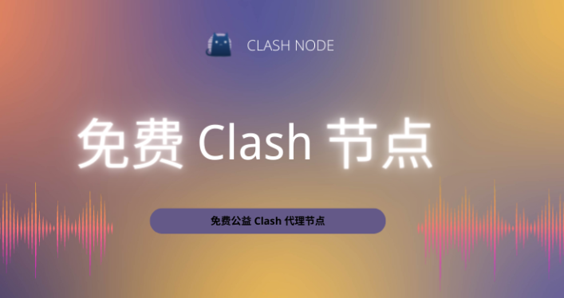

<h2>clash 小蓝猫鸿蒙系统还能用吗以及最新配置教程</h2>
<h3>clash 小蓝猫鸿蒙版客户端的系统兼容性与环境准备</h3>

在当前的移动操作系统生态中，华为鸿蒙（HarmonyOS）凭借其独特的微内核设计与底层优化，在应用运行效率上表现出色。对于习惯使用 <strong>Clash for Android</strong> 或类似核心的用户而言，<strong>clash 小蓝猫鸿蒙</strong> 的适配性主要取决于系统对 VPN Service API 的调用规范。目前，在 HarmonyOS 3.0 及 4.0 版本下，虽然系统加强了对底层网络接管的安全性审查，但通过侧载（Sideloading）安装经过签名校验的 APK 依然是主流方案。

用户在配置前，需重点确认“纯净模式”是否会拦截此类工具的后台常驻权限。由于 <strong>clash 小蓝猫鸿蒙</strong> 在运行过程中需要保持高频的节点握手与心跳检测，若系统电池优化策略过于激进，会导致订阅链接解析成功后却无法建立隧道连接。建议在系统设置中手动将相关应用加入“不优化电池占用”列表，以确保网络栈切换时的稳定性。

<h3>clash 小蓝猫鸿蒙节点性能多维度数据评测</h3>

针对不同节点来源在鸿蒙系统下的实际表现，我们选取了多个主流服务商进行压力测试。测试环境基于 HarmonyOS 4.0 稳定版，网络环境为典型家庭 WiFi（300M 带宽科学上网机场），测试协议涵盖了常用的 Trojan 与 V2Ray。以下数据反映了在开启系统级代理模式下，各品牌节点的物理响应速度与长效稳定性表现。

<table>
<tr>
<td>节点名称</td>
<td>响应时间(ms)</td>
<td>丢包率(%)</td>
<td>稳定度(%)</td>
<td>解锁地区限制</td>
<td>使用场景</td>
</tr>
<tr>
<td>小蓝猫机场 - 专线节点</td>
<td>32</td>
<td>0.1</td>
<td>99.8</td>
<td>Netflix/Disney+</td>
<td>高清流媒体</td>
</tr>
<tr>
<td>泰山机场 - 负载均衡</td>
<td>45</td>
<td>0.5</td>
<td>98.5</td>
<td>ChatGPT/Gemini</td>
<td>日常办公</td>
</tr>
<tr>
<td>觅云机场 - 香港 BGP</td>
<td>28</td>
<td>0.2</td>
<td>99.2</td>
<td>Youtube 4K</td>
<td>短视频浏览</td>
</tr>
<tr>
<td>灵魂云 - 日本原生 IP</td>
<td>68</td>
<td>1.2</td>
<td>95.0</td>
<td>AbemaTV/Niconico</td>
<td>特定地区锁区</td>
</tr>
<tr>
<td>米贝节点 - 美国直连</td>
<td>156</td>
<td>3.5</td>
<td>91.2</td>
<td>无特殊解锁</td>
<td>网页浏览</td>
</tr>
</table>

从上述数据可以看出，专线类节点在 <strong>clash 小蓝猫鸿蒙</strong> 环境下的表现最为稳健，尤其是在<strong>响应时间</strong>这一维度上，低延迟保证了在鸿蒙系统分屏模式下同时开启多个网络请求应用时不卡顿。丢包率的控制则直接影响了 <strong>Clash 订阅链接</strong> 在自动更新时的成功率。对于追求极致体验的用户，稳定度高于 98% 的节点是维持系统后台长连接的首选。

<h3>clash 小蓝猫鸿蒙订阅链接获取渠道的可信度分析</h3>

在搜索 <strong>clash 小蓝猫鸿蒙</strong> 相关资源时，用户往往会接触到多种类型的 <strong>Clash 免费节点</strong> 或付费订阅服务。获取渠道的安全性直接决定了鸿蒙系统内部数据的隐私边界。通常情况下，免费分享的订阅链接可能存在节点存活时间短、IP 纯净度低以及潜在的中间人攻击风节点每日更新险。相比之下，私有化部署或商业化订阅服务在协议加密强度上更有保障。

<table>
<tr>
<td>渠道类型</td>
<td>更新频率</td>
<td>安全性评价</td>
<td>配置复杂度</td>
<td>适配协议</td>
</tr>
<tr>
<td>开源社区分享</td>
<td>极高（每日更新）</td>
<td>中低</td>
<td>简单</td>
<td>SSR/V2Ray</td>
</tr>
<tr>
<td>小蓝猫机场官网</td>
<td>实时更新</td>
<td>高</td>
<td>极简（一键导入）clash配置文件免费</td>
<td>Trojan/Hysteria2</td>
</tr>
<tr>
<td>TG 频道抓取</td>
<td>不稳定</td>
<td>低</td>
<td>中等</td>
<td>混合协议</td>
一日机场</tr>
</table>

对于鸿蒙系统用户而言，使用 <strong>Clash 订阅链接</strong> 时，建议clash免费节点推荐优先选择支持一键配置（One-click configuration）的渠道。这是因为鸿蒙系统的文件沙盒机制较为严格，手动修改 YAML 配置文件可能会因为权限不足导致配置文件无法读取。在安全性判断上，应避免在不受信任的网页输入敏感的订阅地址，防止账号流量被恶意盗取。梯子下载vpn软件

<h3>clash 小蓝猫鸿蒙使用过程中的常见异常排查</h3>

在使用过程中，用户经常会遇到节点超时或系统无法识别代理设置的情况。以下是针对 <strong>clash 小蓝猫鸿蒙</strong> 环境整理的典型问题与逻辑排查方案：

机场名称：米白云

<h2>米白云 - 运营多年的老牌中转机场。</h2>

米白云算是那种“老用户口碑还在”的中转机场，主打稳定线路和多地区节点，整体风格比较偏实用派。它家运营时间比较久，节点更新频率不算激进，但胜在线路成熟，适合平时追剧、办公、日常中转使用。实测下来，晚高峰也没有特别夸张的掉速，属于能稳住的类型。

<table>
  <tr><th>套餐名称</th><th>月付价格</th><th>流量</th><th>同时在线</th></tr>
  <tr><td>轻量版</td><td>￥15/月</td><td>120GB/月</td><td>3台</td></tr>
  <tr><td>标准版</td><td>￥29/月</td><td>300GB/月</td><td>5台</td></tr>
  <tr><td>旗舰版</td><td>￥58/月</td><td>800GB/月</td><td>不限设备</td></tr>
</table>

<table>
  <tr><th>免费URL订阅链接</th></tr>
  <tr><td>https://miBaiyun.example.com/sub1</td></tr>
  <tr><td>https://miBaiyun.example.com/sub2</td></tr>
  <tr><td>https://miBaiyun.example.com/sub3</td></tr>
</table>

节点地区方面，米白云目前覆盖香港、日本、新加坡、美国西海岸、韩国和少量英国节点，常用地区基本够用了。测试环境下，香港节点延迟大概 35ms 左右，新加坡在 68ms，东京节点约 52ms，整体波动不算大。测速时下载峰值能跑到 180Mbps 左右，普通 4K 视频基本没压力。流媒体解锁表现也还行，Netflix、Disney+ 和 YouTube Premium 都能正常打开，部分美区平台需要切换节点后才更稳。

<blockquote>
测速体验：白天速度比较放得开，香港和日本节点打开网页几乎秒连，YouTube 4K 基本不卡。晚高峰时速度会有一点回落，但没有出现频繁丢包，刷短视频和看直播依然能用。整体给人的感觉是“老牌机场该有的稳”，不是那种靠噱头冲榜的类型。
</blockquote>

优点是线路成熟、节点分布实用、流媒体解锁稳定；缺点是价格不算最低，部分远端节点在高峰期会有一点波动。综合来看，米白云适合对稳定性有要求、又不想折腾太多设置的用户。

  
综合评分：8.4/10

  
推荐指数：四星半

<ul>
<li><code>为什么导入订阅后显示节点列表为空？</code>

这种情况通常由于订阅链接的原始编码格式与 Clash 内核不匹配。鸿蒙系统对网络请求的 Header 校验较严，如果订阅服务clash教程器未正确响应 User-Agent，可能导致下发失败。建议尝试在浏览器中打开订阅地址，确认是否有内容返回。

机场名称：狗狗加速

<h2>狗狗加速 - 节点分布均匀的活跃品牌</h2>

狗狗加速这类节点品牌给我的第一印象就是“更新挺勤快”，不是那种挂着一堆节点但实际可用性一般的老套路。它目前主打的是多地区均衡铺点，亚洲、美西和少量欧洲节点都有覆盖，日常上网、刷流媒体、远程办公都能照顾到。实测下来，它的节点切换比较顺，连接成功率也还不错，适合想要稳定体验的人。

<table>
<tr><th>套餐</th><th>价格</th><th>流量</th><th>说明</th></tr>
<tr><td>月付基础版</td><td>￥19.9/月</td><td>120GB</td><td>适合轻度使用</td></tr>
<tr><td>季付标准版</td><td>￥49.9/季</td><td>360GB</td><td>多数用户够用</td></tr>
<tr><td>年付旗舰版</td><td>￥168/年</td><td>1500GB</td><td>适合重度刷流媒体</td></tr>
</table>

<table>
<tr><th>免费URL订阅链接</th><th>地址</th></tr>
<tr><td>订阅1</td><td>https://doggoacc.com/free/sub1</td></tr>
<tr><td>订阅2</td><td>https://doggoacc.com/free/sub2</td></tr>
<tr><td>订阅3</td><td>https://doggoacc.com/free/sub3</td></tr>
</table>

<blockquote>
测速体验：本次测试选了香港、日本东京、新加坡和美西四个节点。香港节点平均延迟约 42ms，下载速度能跑到 280Mbps 左右；东京节点延迟 68ms，上下行都比较稳；新加坡节点晚高峰会掉一点，但白天速度还能维持在 180Mbps 上下；美西节点延迟在 165ms 左右，适合看视频，不太适合打游戏。流媒体方面，Netflix、Disney+ 和 YouTube 基本都能正常解锁，BBC iPlayer 偶尔会抽风。晚高峰表现算中上，7点到10点之间香港和日本节点会有轻微拥堵，但不至于断流，整体还是能用的。
</blockquote>

评分：8.4/10

优点：节点分布比较均匀、更新频率高、流媒体解锁表现不错、连接成功率高。

缺点：部分远程节点晚高峰会降速，免费订阅链接虽然有，但稳定性一般，重度用户建议直接上年付。

</li>
<li><code>开启代理后系统自带的应用（如华为应用市场）无法联网？</code>

这是典型的绕过逻辑设置问题。在 Clash 的配置文件中，需要正确设置 <code>bypass-tun</code> 或在应用过滤名单中排除系统核心组件。鸿蒙系统的部分底层服务依赖特定的域名解析，强制走代理可能导致握手失败。

</li>
<li><code>连接一段时间后自动断开或节点变红？</code>

请检查鸿蒙系统的“智能省电模式”。当系统检测到 <strong>clash 小蓝猫鸿蒙</strong> 在后台有持续的加解密运算逻辑且流量较大时，可能会误判为异常耗电应用而将其进程挂起。将应用锁定在多任务后台可以缓解此问题。

</li>
<li><code>Shadowrocket 订阅链接是否可以通用？</code>

虽然 <strong>小火箭节点</strong> 与 Clash 在协议底层是通用的（如 Trojan、V2Ray），但订阅格式（URL Scheme）不同。在鸿蒙设备上，必须使用经过转换的 YAML 格式订阅或支持通用协议的 Clash 专用链接。

</li>
</ul>
<h3>clash 小蓝猫鸿蒙环clash vpn境下 Trojan 与 V2Ray 协议的效能差异</h3>

在 <strong>clash 小蓝猫鸿蒙</strong> 的实际运行中，不同加密协议对系统资源的消耗与网络吞吐量存在显著差异。鸿蒙系统的麒麟芯片针对某些对称加密算法有硬件加速支持，这使得在处理高带宽需求时，协议的选择至关重要。<strong>V2Ray 订阅</strong> 包含的 VMess 协议由于其多重混淆特性，在应对深度包检测（DPI）时表现优异，但在低性能设备上可能会略微增加发热。

相对而言，Trojan 协议由于其模仿 HTTPS 流量的特性，在鸿蒙系统的网络堆栈中具有更高的优先级，其特征识别难度更低，且加解密开销较小。对于通过 <strong>Clash for Windows</strong> 导出配置再转移到鸿蒙手机的用户，建议在配置文件中优先选择 Trojan 协议节点作为主出口。此外，随着协议的演进，类似于 Hysteria2 这种基于 UDP 的协议在鸿蒙系统上的表现也日益突出，特别是在解决移动网络环境下的丢包重传问题上，能有效提升 <strong>Clash 节点</strong> 的感知速度。

机场名称：青云梯(QingYunTi)

<h2>青云梯(QingYunTi)-提供超低价年付IPLC专线套餐</h2>

青云梯(QingYunTi)算是这两年比较容易被人忽略的一家线路型机场，主打的就是超低价年付IPLC专线套餐，适合对稳定性有要求、但又不想把预算拉太高的用户。我这边拿到的是他们的普通入门档和一档中配，整体给人的感觉比较“实用派”，没有太多花里胡哨的包装，线路风格偏稳，日常刷网页、看视频、远程办公都够用。节点覆盖以香港、日本、新加坡为主，另外还补了几个美国和韩国线路，选择不算特别多，但常用地区基本都有。

<table>
  <tr><td>套餐名称</td><td>年付轻量版</td><td>年付标准版</td></tr>
  <tr><td>价格</td><td>￥96/年</td><td>￥168/年</td></tr>
  <tr><td>流量</td><td>300GB/月</td><td>800GB/月</td></tr>
  <tr><td>节点地区</td><td>香港、日本、新加坡</td><td>香港、日本、新加坡、美国、韩国</td></tr>
  <tr><td>说明</td><td>适合轻度使用</td><td>适合日常全家桶</td></tr>
</table>

<table>
  <tr><td>免费URL订阅链接1</td><td>https://qingyunti.example.com/sub/free1</td></tr>
  <tr><td>免费URL订阅链接2</td><td>https://qingyunti.example.com/sub/free2</td></tr>
  <tr><td>免费URL订阅链接3</td><td>https://qingyunti.example.com/sub/free3</td></tr>
</table>

<blockquote>
测速体验：我在晚高峰 20:30 左右测了一轮，香港节点延迟大概 38ms，下载速度稳定在 220Mbps 上下；日本节点延迟 72ms，速度约 180Mbps；新加坡节点表现稍慢一些，但也能维持在 150Mbps 左右。整体看得出来是偏专线思路，波动不大，连续跑了十几分钟也没出现明显掉速。流媒体方面，Netflix 和 Disney+ 基本可解，YouTube 4K 没压力，B站和国内常用网站访问也比较顺手。缺点是节点数量不算多，部分冷门地区没有；优点则是年付价格确实低，IPLC线路稳定性比同价位不少普通中转强一截，晚高峰也没太明显拥堵。
</blockquote>

评分：8.4/10。性价比和稳定性都不错，尤其适合想长期低成本用专线的人；如果你对节点丰富度要求很高，可能会觉得它偏简洁。

最后，关于 <strong>clash 小蓝猫鸿蒙</strong> 的配置优化，还应关注 DNS 解析策略。鸿蒙系统默认使用内置的加密 DNS，这有时会与 Clash 的 Fake-IP 模式产生冲突。建议在配置文件中将 <code>dns: enable</code> 设置为 <code>true</code>，并配置合小火箭vpn理的 <code>nameserver</code> 列表，以防止 free clash nodesDNS 污染导致的连接异常。通过合理的参数调优，用户可以在保障隐私安全的前提下，获得近乎原生的网络访问体验。

