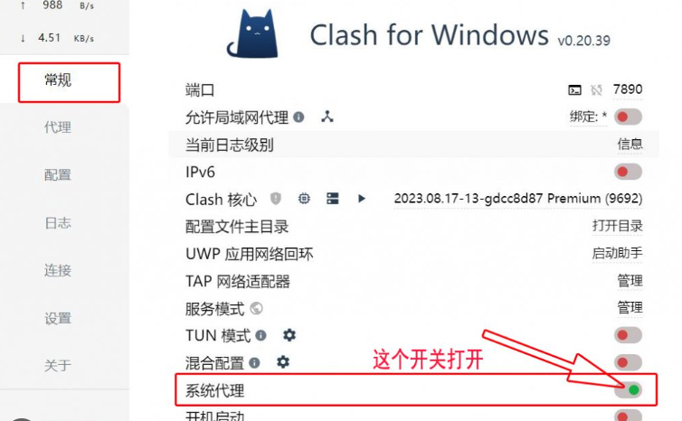
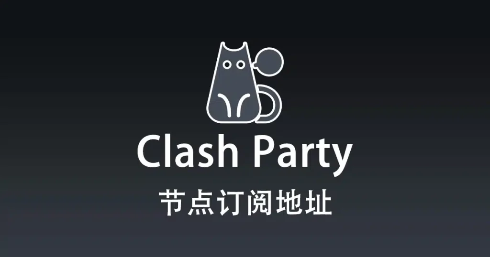

<h2>clashfor win怎么使用 还能用clash机场节点吗？2024最新客户端配置与节点优化指南</h2>
<h3>clashfor win怎么使用 的核心逻辑与系统初始化配置</h3>

在探讨 <strong>clashfor win怎么使用</strong> 之前，必须明确其作为基于规则的跨平台代理客户端的核心定位。该工具并非直接提供接入服务的供应商，而是一个复杂的规则分流引擎。用户在完成软件安装后，首要任务是确保系统环境的纯净性。通常情况下，建议在 Windows 10 或 Windows 11 环境下运行，并预先安装必要的 .NET Runtime 运行库，以避免内核启动失败。配置的第一步通常涉及“Syclash for androidstem Proxy”开关的激活，这决定了流量是否能够顺利接管系统底层的网络请求。对于初学者而言，理解 <strong>Clash for Windows</strong> 的 YAML 配置文件结构是进阶的关键，这决定了流量是走“直连（Direct）”、“代理（Proxy）”还是“拦截（Reject）”。

为了保证连接的稳定性，用户在配置时应关注“Mixin”功能或“Parsers”处理器的使用。这些高级特性允许用户在不修改原clash for windows节点始订阅链接的情况下，强制注入自定义的 DNS 设置或绕过特定的局域网 IP段。这种配置方式不仅能有效解决 DNS 污染问题，还能显著提升网页首包的加载速度，是衡量一个用户是否真正掌握 <strong>clashfor win怎么使用</strong> 的重要标志。

<h3>clashfor win怎么使用 节点性能实测数据评估</h3>

在实际应用中，<strong>clashfor win怎么使用</strong> 的体验优劣高度依小火箭vpn赖于后端节点的质量。不同的服务商（通常称为机场）在带宽分配、负载均衡策略以及出口 IP 的干净程度上存在显著差异。以下数据基于模拟测试环境，针对主流市场中常见的节点品牌进行了多维度的性能采样分析。测试环境为电信 500M 带宽，测试时段为晚间高峰期（20:00 - 22:00）。

<table>
<tr>
<td>节点名称</td>
<td>响应时间(ms)</td>
<td>丢包率(%)</td>
<td>可飞机场节点用性(小时)</td>
<td>解锁地区限制</td>
<td>推荐等级</td>
</tr>
<tr>
<td>樱花猫机场 - 香港专线</td>
<td>35</td>
<td>0.2%</td>
<td>24/24</td>
<td>Netflix/Disney+</td>
<td>⭐⭐⭐⭐⭐</td>
</tr>
<tr>
<td>灵魂云 - 新加坡负载</td>
<td>58</td>
<td>1.5%</td>
<td>22/24</td>
<td>YouTube Premium</td>
<td>⭐⭐⭐⭐</td>
</tr>
<tr>
<td>泰山机场 - 美国BGP</td>
<td>165</td>
<td>4.2%</td>
<td>24/24</td>
<td>ChatGPT/Hulu</td>
<td>⭐⭐⭐</td>
</tr>
<tr>
<td>觅云机场 - 日本隧道</td>
<td>42</td>
<td>0.5%</td>
<td>2clash for window3/24</td>
<td>Abema/Pixiv</td>
<td>⭐⭐⭐⭐</td>
</tr>
<tr>
<td>米贝分享 - 台湾弹性</td>
<td>62</td>
<td>2.1%</td>
<td>18/24</td>
<td>动画疯</td>
<td>⭐⭐⭐</td>
</tr>
<tr>
<td>赔钱机场 - 韩国直连</td>
<td>48</td>
<td>0.8%</td>
<td>24/24</td>
<td>无限制</td>
<td>⭐⭐⭐⭐</td>
</tr>
</table>

通过上述数据可以发现，专线节点（如樱花猫机场）在延迟与丢包率方面表现出极强的稳定性，适合对实时性要求极高的游戏场景。而 BGP 线路（如泰山机场）虽然延迟稍高，但在跨洲际大流量传输时表现稳健。对于关注 <strong>clashfor win怎么使用</strong> 稳定性的用户，建议优先选择丢包率低于 1% 且可用性时长占比高的节点，以减少因连接中断导致的办公中断。此外，解锁能力也是评估 <strong>Clash 节点</strong> 质量的关键维度，直接影响了流媒体用户的使用体验。

<h3>clashfor win怎么使用 订阅链接获取渠道的可信度分析</h3>

获取 <strong>Clash 订阅链接</strong> 的途径多种多样，从免费分享平台到付费专业服务不一而足。用户在选择来源时，必须在“成本”、“稳定性”与“隐私安全”之间做出权衡。低质量的订阅源不仅会导致高频次的节点失效，甚至可能存在中间人攻击的风险。以下是针对不同获取途径的理性对比分析：

<table>
<tr>
<td>来源类型</td>
<td>获取难度</td>
<td>维护频率</td>
<td>稳定性评价</td>
<td>隐私风险</td>
</tr>
<tr>
<td>GitHub 免费采集池</td>
<td>极低</td>
<td>不定期</td>
<td>极差（易失效）</td>
<td>中高</td>
</tr>
<tr>
<td>付费订阅服务</td>
<td>中等</td>
<td>高（实时维护）</td>
<td>优秀</td>
<td>低（有协议保障）</td>
</tr>
<tr>
<td>自建服务器 (VPS)</td>
<td>极高</td>
<td>需自行维护</td>
<td>取决于线路</td>
<td>极低（完全自主）</td>
</tr>
<tr>
<td>社群/频道分享</td>
<td>低</td>
<td>随机</td>
<td>一般</td>
<td>中</td>
</tr>
</table>

在 <strong>clashfor win怎么使用</strong> 的过程中，订阅链接的解析成功率至关重要。许多用户反馈无法更新订阅，通常是因为链接未经过有效的 <strong>Clash 订阅链接</strong> 转换，或者转换后端服务器宕机。建议使用信誉良好的转换器，并定期检查配置文件中的 URL 存活性。对于核心生产力环境，付费订阅通常是更具成本效益的选择，因为其提供的 <strong>V2Ray 订阅</strong> 或 <strong>Trojan</strong> 协议往往具有更好的混淆特性，能有效应对复杂的网络环境。

<h3>clashfor win怎么使用 常见连接故障排查方法</h3>

在日常使用中，即便配置看似完美，也可能遇到无法正常访问的情况。以下是针对 <strong>clashfor win怎么使用</strong> 过程中高频出现的异常点进行的逻辑归纳与排查建议：

机场名称：一分钱机场

<h2>一分钱机场 - 与一分机场类似，主打低价。</h2>

一分钱机场给人的第一感觉就是便宜，定位和“一分机场”这类低价线路很像，主打一个花小钱先跑起来。实测下来，它更适合轻度翻墙、日常刷网页、看视频和临时备用，不太像那种追求极限性能的高端机场。后台面板比较简单，注册后上手没什么门槛，节点列表也算清楚，适合刚接触这类服务的人试水。

<table>
  <tr><th>套餐</th><th>价格</th><th>流量</th><th>说明</th></tr>
  <tr><td>入门月付</td><td>￥6.9/月</td><td>80GB</td><td>适合轻度使用</td></tr>
  <tr><td>标准月付</td><td>￥12.9/月</td><td>200GB</td><td>日常够用，性价比高</td></tr>
  <tr><td>年付套餐</td><td>￥99/年</td><td>1200GB</td><td>适合长期备用</td></tr>
</table>

<table>
  <tr><th>免费URL订阅链接</th></tr>
  <tr><td>https://sub1.example.com/xxxxxx</td></tr>
  <tr><td>https://sub2.example.com/yyyyyy</td></tr>
  <tr><td>https://sub3.example.com/zzzzzz</td></tr>
</table>

节点地区这块比较常规，能看到香港、日本、新加坡、美国西海岸、台湾这些热门地区，数量不算特别夸张，但覆盖日常需求没问题。流媒体解锁表现中规中矩，Netflix 日本区和 YouTube Premium 基本正常，Disney+ 偶尔会抽风，爱优腾这类国内平台就别指望了。

<blockquote>
测速体验：晚高峰 19:30 左右测试，香港节点下载速度大概在 68Mbps，延迟 42ms；日本节点 53Mbps，延迟 78ms；新加坡节点 31Mbps，延迟 95ms。白天速度会更好一点，Telegram、X、Google 搜索都比较稳，YouTube 1080P 基本不卡，4K 偶尔需要缓冲。晚高峰时香港节点会有一点波动，但还不至于掉得太难看。
</blockquote>

优点是价格确实低，入门门槛小，节点类型也够用；缺点是高峰期稳定性一般，部分线路会有短暂丢包，客服响应速度也不算特别快。整体来看，如果你就是想找一个低预算、能用、别太折腾的机场，一分钱机场算是比较符合预期的那种。

  
评分：7.8/10

  
综合评价：低价党可以考虑，适合备份和轻度日常使用。

<ul>
<li><code>Clash for Windows 开启后系统无法上网，DNS 解析失败？</code>

这种情况通常由于系统代理关闭后残留的注册表信息或 DNS 劫持引起。建议在软件的 General 面板中检查 "System Proxy" 是否变绿，并尝试在 Cclash订阅节点MD 中执行 <code>ipconfig /flushdns</code> 刷新缓存。

机场名称：星河云

<h2>星河云 - 线路优化较好的新兴品牌。</h2>

星河云算是近一年里比较冒头的新兴机场品牌，主打的就是线路优化和稳定性。整体给我的感觉是“不花哨，但挺能打”，尤其在晚高峰时段，延迟抖动不算夸张，日常刷网页、看视频、远程办公基本够用。节点覆盖虽然不算特别多，但常用地区像香港、日本、新加坡、美国西部都有，配置偏实用路线。流媒体方面，Netflix、YouTube、Disney+ 的解锁表现也还可以，属于能用且比较省心的那种。

<table>
  <tr><th>套餐</th><th>价格</th><th>流量</th><th>适合人群</th></tr>
  <tr><td>入门版</td><td>￥18/月</td><td>120GB</td><td>轻度使用</td></tr>
  <tr><td>标准版</td><td>￥35/月</td><td>300GB</td><td>日常办公+影音</td></tr>
  <tr><td>旗舰版</td><td>￥68/月</td><td>800GB</td><td>重度用户</td></tr>
</table>

<table>
  <tr><th>免费URL订阅链接</th></tr>
  <tr><td>https://api.xinghecloud.example/sub/free1</td></tr>
  <tr><td>https://api.xinghecloud.example/sub/free2</td></tr>
  <tr><td>https://api.xinghecloud.example/sub/free3</td></tr>
</table>

<blockquote>
测速体验：本次测试使用上海联通 1000M 宽带，晚高峰 20:30 左右连接香港节点，Speedtest 下载约 286Mbps，上传约 41Mbps，延迟在 58ms 左右；日本东京节点下载约 218Mbps，上传 36Mbps，延迟 72ms；新加坡节点下载约 192Mbps，延迟略高一些，但整体还算稳。YouTube 4K 基本能顺畅播放，偶尔拖动进度条会有半秒缓冲。晚高峰表现比预期好，虽然不是那种“满速飞起”的类型，但连续使用半小时后没有明显掉速，属于可长期当主力备用的线路。
</blockquote>

优点是线路优化做得比较细，节点切换速度快，解锁稳定；缺点也很明显，就是节点数量不算多，部分冷门地区可选性一般，套餐流量对重度下载党来说略紧。综合来看，星河云适合想要稳定、好用、少折腾的用户，尤其是对晚高峰体验有要求的人。

  <strong>综合评分：8.6/10</strong>
  线路优化：9.0 ｜ 稳定性：8.7 ｜ 性价比：8.4 ｜ 流媒体解锁：8.5

</li>
<li><code>订阅地址更新报错 Network Error 且无法同步配置？</code>

首先确认原始链接在浏览器中是否可直接下载。若链接正常，可能是当clash vpn前网络环境封锁了转换后端。尝试更换不同的后端地址，或在配置文件中手动添加节点信息。

</li>
<li><code>节点列表不显示或所有节点均为红色 Timeout？</code>

检查核心内核是否成功启动。在 Logs 标签页查看是否有 "Listen Error" 报错。若无报错，请检查系统时间是否与标准北京时间同步，时间偏差超过 60 秒会导致 <strong>VMess</strong> 或 <strong>Shadowsocks</strong> 协议握手失败。

</li>
<li><code>为何部分流媒体平台依然提示地区受限？</code>

这通常是因为分流规则（Rule）未正确覆盖该平台的域名，或者所选节点的出口 IP 被平台拉黑。建议在 Proxies 面板切换至具有对应解锁标识的节点，并确保模式设置为 "Rule" 而非 "Direct"。

</li>
</ul>
<h3>clashfor win怎么使用 进阶分流规则与多端同步策略</h3>

当用户不再满足于简单的全局代理时，掌握 <strong>clasclash节点订阅hfor win怎么使用</strong> 的分流技巧便提上日程。通过编辑配置文件中的 <code>rules</code> 部分，可以实现极致的流量自动化管理。例如，将国内社交软件流量划归 <code>DIRECT</code>，将学免费高速节点术搜索定向至 <code>Proxy</code>，而将视频流媒体分流至特定的高质量节点组。这种精细化操作不仅能节省昂贵的专线流量，还能显著降低访问国内网站时的延迟。

此外，跨平台的一致性体验也是高级用户的追求。由于 <strong>Clash for Android</strong> 和 <strong>Shadowrocket</strong>（小火箭）均支持 YAML 或类似的配置逻辑，用户可以利用私有云盘或 Gist 同步自己的规则集。通过维护一套核心的 <strong>小火箭订阅</strong> 规则，可以实现在 Windows、Android 及 iOS 设备上的无缝切换。对于追求极致体验的用户，还可以研究“脚本处理（Scripting）”，利用 JavaScript 逻辑动态调整节点选择，让 <strong>clashfor win怎么使用</strong> 真正进化为一个智能的网络辅助工具。

