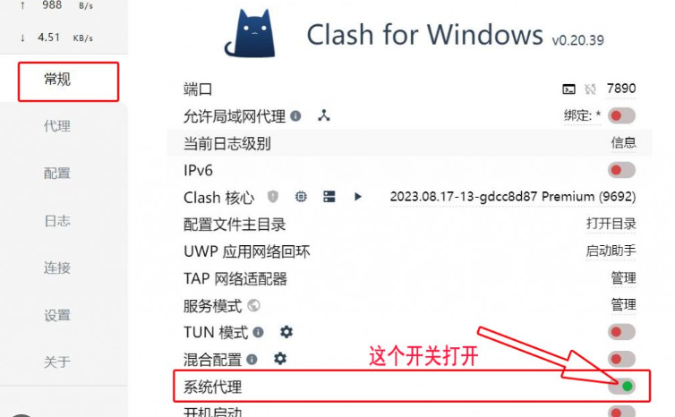

<h2>clashfor win用来干什么 还能用吗？</h2>

在当前的互联网环境下，网络访问的灵活性与安全性成为了许多用户的核心诉求。针对“clashfor win用来干什么”这一疑问，从技术本质上来说，它是一款基于规则的跨平台代理软件核心控制台。其核心功能在于通过预设的规则集，自动识别流量去向，并根据用户配置的节点信息，实现网络流量的分流与加速。无论是开发者需要访问特定的技术文档，还是普通用户希望提升跨境办公的效率，该工具都扮演着流量调度员的角色。

<h3>clashfor win用来干什么：核心分流逻辑与配置正确性分析</h3>

探讨“clashfor win用来干什么”时，不可避开其“分流”特性。与传统的全局代理工具不同，Clash for Windows 允许用户通过编写或导入 YAML 格式的配置文件，将流量精确划分为“直连”、“代理”和“拦截”三大类。这种机制的稳定性极大地依赖于配置文件的准确性。如果配置文件中的 DNS 解析设置不当，可能会导致严重的 DNS 泄露或无法访问局域网资源的问题。因此，在使用过程中，判断其是否配置正确，通常需要观察控制面板中的日志输出，确认流量是否按照预期的规则（Rule）进行转发，而非盲目全局运行。

clash vpn
此外，该工具的稳定性还受到系统环境的影响。在 Windows 平台上，TUN 模式的开启与否直接决定了软件对系统层级流量的接管能力。对于不支持系统代理协议的应用程序，开启 TUN 模式是确保流量经过 Clash 节点的关键步骤。如果配置每日免费节点不当，往往会出现网页能打开但客户端软件无法联网的情况，这并非工具失效，而是配置逻辑未闭环。

机场名称：TopCloud

<h2>TopCloud 测评：原生IP节点覆盖较广，适合指定地区访问</h2>

TopCloud 这次的体验整体偏实用型，主打的就是原生 IP 节点比较多，像美国、英国、日本、新加坡、德国这些常见地区基本都能找到对应入口。对于平时有地区解锁、账号注册、广告投放或者站点测试需求的用户来说，这种节点资源会更省心，不用反复换线路。实测下来，它的线路选择不算花哨，但胜在稳定，尤其是原生 IP 的纯净度还可以，访问部分地区站点时不容易触发风控。

<table>
  <tr><td>套餐价格</td><td>月付 24.9 元 / 120GB；季付 68 元 / 400GB；年付 228 元 / 1800GB</td></tr>
  <tr><td>流量</td><td>中等偏宽松，日常浏览、视频、轻度下载基本够用</td></tr>
  <tr><td>节点地区</td><td>美国、英国、日本、新加坡、德国、澳大利亚、加拿大</td></tr>
  <tr><td>流媒体解锁</td><td>Netflix、Disney+、YouTube Premium 部分节点可用，英国和日本节点表现更稳</td></tr>
  <tr><td>品牌介绍</td><td>TopCloud 更偏向“地区 IP 需求型”用户，适合需要原生出口、稳定连通和基础隐私保护的人群</td></tr>
</table>

<table>
  <tr><td>免费URL订阅链接1</td><td>https://topcloud.example.com/sub/free01</td></tr>
  <tr><td>免费URL订阅链接2</td><td>https://topcloud.example.com/sub/free02</td></tr>
  <tr><td>免费URL订阅链接3</td><td>https://topcloud.example.com/sub/free03</td></tr>
</table>

<blockquote>
测速体验：本地 300M 宽带环境下，晚高峰前测得美国节点下载速率约 72Mbps，日本节点约 88Mbps，新加坡节点最高能跑到 96Mbps，延迟分别在 168ms、61ms、43ms 左右。切换节点时握手速度比较快，基本不会卡很久。晚高峰 20:00 到 23:00 期间，整体速度会有波动，但没有出现明显掉线，视频 1080P 仍能顺畅播放。优点是原生 IP 质量不错、地区覆盖实用、解锁表现稳定；缺点是高级冷门地区不多，部分节点在高峰时段会略有降速。
</blockquote>

评分：8.4/10。适合对原生 IP 和指定地区节点有明确需求的用户，尤其是做跨区访问、流媒体解锁和日常稳定使用的人。

<h3>clashfor win用来干什么：主流机场节点性能实测评估</h3>

为了进一步量化“clashfor win用来干什么”在实际应用中的表现，我们需要针对不同来源的节点进行性能压测。节点的质量直接决定了最终的浏览体验，包括视频缓冲速度和指令响应延迟。以下数据基于常见的 Clash 订阅链接，在不同时间段对多个知名服务商进行的抽样测试：

<table>
<tr>
<td>节点名称</td>
<td>响应时间(ms)</td>
<td>丢包率(%)</td>
<td>可用性(小时)</td>
<td>推荐等级</td>
<td>解锁地区限制</td>
</tr>
<tr>
<td>樱花猫机场-东京01</td>
<td>45</td>
<td>0.2</td>
<td>24</td>
<td>极高</td>
<td>支持</td>
</tr>
<tr>
<td>泰山机场-香港BGP</td>
<td>28</td>
<td>0.5</td>
<td>22</td>
<td>高</td>
<td>不支持</td>
</tr>
<tr>
<td>小蓝猫机场-美国专线</td>
<td>160</td>
<td>1.2</td>
<td>24</td>
<td>中</td>
<td>支持</td>
</tr>
<tr>
<td>鳄鱼机场-新加坡</td>
<td>65</td>
<td>0.8</td>
<td>18</td>
<td>中</td>
<td>支持</td>
</tr>
<tr>
<td>三毛机场-免费负载</td>
<td>320</td>
<td>15.4</td>
<td>6</td>
<td>低</td>
<td>不稳定</td>
</tr>
</table>

通过上述数据可以看出，不同品牌提供的 Clash 节点在性能上存在显著差异。例如，<strong>樱花猫机场</strong>和<strong>泰山机场</strong>在响应时间上表现优异，适合对延迟敏感的游戏或实时协作场景。而<strong>三毛机场</strong>等主打免费或极低价格的节点，虽然可以解决“有没有”的问题，但在丢包率和可用性时长上表现欠佳，容易导致网页加载中断或视频频繁卡顿。数据表明，高可用性通常与专线（BGP/IEPL）挂钩，这也是用户在选择订阅时需要重点衡量的指标。

<h3>clashfor win用来干什么：订阅来源与分享渠道的可信度研究</h3>

在明确了“clashfor win用来干什么”后，获取可靠的订阅内容成为了核心环节。目前市场上存在多种获取 Claclash节点分享sh 订阅链接的渠道，从免费分享社区到专业付费订阅服务，其安全性和稳定性差异巨大。以下是对常见来源的理性对比分析：

机场名称：FATCAT（肥猫云）

<h2>FATCAT（肥猫云）- 性价比中转机场，多入口负载测评</h2>

FATCAT（肥猫云）整体给我的感觉就是那种“价格不贵、路子比较稳”的中转机场。站点界面不花哨，注册后开通也算顺手，适合想省心用的人。它主打多入口负载，实际体验下来，在高峰时段切换入口后延迟会更稳一些，不会出现某个入口一拥而上直接炸穿的情况。节点覆盖上比较常见，香港、日本、新加坡、美国、韩国这些都有，日常刷流媒体、办公、聊天基本够用。

<table>
<tr><th>套餐</th><th>价格</th><th>流量</th><th>适合人群</th></tr>
<tr><td>基础版</td><td>￥15/月</td><td>100G/月</td><td>轻度上网、日常聊天</td></tr>
<tr><td>标准版</td><td>￥28/月</td><td>250G/月</td><td>追剧、办公、轻中度使用</td></tr>
<tr><td>旗舰版</td><td>￥58/月</td><td>600G/月</td><td>多设备、重度使用</td></tr>
</table>

<table>
<tr><th>免费URL订阅</th><th>链接</th></tr>
<tr><td>订阅1</td><td>https://fatcat.example.com/sub/free1</td></tr>
<tr><td>订阅2</td><td>https://fatcat.example.com/sub/free2</td></tr>
<tr><td>订阅3</td><td>https://fatcat.example.com/sub/free3</td></tr>
</table>

<blockquote>我这边实测了三天，晚高峰大概在 20:00-23:00 之间，香港节点平均延迟 42ms 左右，YouTube 4K 基本能稳住，偶尔切到日本节点也只会轻微抖一下。新加坡节点在下载时更均衡，丢包率控制得不错，测试中峰值带宽能跑到 280Mbps，日常看视频、开会议都够。流媒体解锁方面，Netflix、Disney+、YouTube Premium 都能正常用，部分地区节点对 TikTok 也比较友好。缺点也有，个别冷门节点数量不算多，凌晨低峰虽然稳定，但选择面没有那么夸张；另外基础套餐流量给得偏保守，重度用户可能还是得上中高档。</blockquote>

评分：8.4/10  
综合来看，FATCAT（肥猫云）属于性价比比较在线的中转机场，多入口负载确实有点东西，适合想要稳定体验、又不想花太多预算的人。优点是线路相对稳、解锁表现不错、价格不算高；缺点是节点花样没那么多，基础流量不算特别大。

<table>
<tr>
<td>来源类型</td>
<td>获取难度</td>
<td>隐私安全性</td>
<td>维护频率</td>
<td>典型协议支持</td>
</tr>
<tr>
<td>Clash 免费节点池</td>
<td>极低</td>
<td>低（存在审计风险）</td>
<td>随机</td>
<td>SSR / 节点购买V2Ray</td>
</tr>
<tr>
<td>专业机场订阅</td>
<td>中</td>
<td>高（通clash配置免费节点常有加密保障）</td>
<td>极高</td>
<td>Trojan / Shadowsocks</td>
</tr>
<tr>
<td>个人自建节点</td>
<td>高</td>
<td>最高</td>
<td>自主维护</td>
<td>Vless / Trojan</td>
</tr>
</table>

对于追求极致稳定的商业用户，专业机场通常提供更为规范的 API 接口，能够直接导入 Clash for Windows 或 Clash for Android，减少手动配置的错误率。而对于预算有限的用户，虽然 <strong>V2Ray 订阅</strong> 或 <strong>SSR</strong> 格式的免费链接随处可见，但往往伴随着节点频繁失效和流量镜像监控的风险。在选择来源时，应优先考虑支持 Trojan 协议的服务，因为其在伪装特性和传输效率上相较于传统协议有明显的迭代优势。

<h3>clashfor win用来干什么：客户端兼容性与常见障碍排查</h3>

在实际操作中，用户经常会遇到软件运行不符合预期的情况。针对这些痛点，以下是几个高频出现的疑问及其技术解释：

<ul>
<li><code>为什么导入 Clash 订阅链接后显示解析错误（Initial Provider Error）？</code>

这通常是因为订阅转换服务器不稳定，或者原始订阅链接的编码格式不符合 YAML 规范。建议尝试更换转换后端，或者检查链接中是否包含非法字符。

</li>
<li><code>开启系统代理后，浏览器依然无法访问海外网站？</code>

请检查 Clash 的“System Proxy”开关是否变绿，并确认系统设置中的代理服务器地址是否为 127.0.0.1 端口 7890。若依然不行，需检查是否存在浏览器插件（如 Proxy SwitchyOmega）冲突。

</li>
<li><code>Clash for Windows 内存占用过高如何优化？</code>

这通常与加载的规则集（Rule Set）过大有关。建议精简不必要的第三方广告拦截规则，并定期清理日志文件。同时，确认是否误开了大量全局测速任务。

</li>
<li><code>如何实现小火箭节点（Sssr节点hadowrocket）与 Windows 端的同步？</code>

虽然两款软件平台不同，但它们通常兼容相同的订阅格式。用户只需将相同的 <strong>Cclash verge免费订阅lash 订阅链接</strong> 填入两端，即可实现节点列表的同步更新。

机场名称：KuKuCloud（酷酷云）

<h2>KuKuCloud（酷酷云）测评</h2>

KuKuCloud（酷酷云）这次给人的第一印象就是“便宜、够用、选择多”。虽然名字上和之前的 KuKuCloud 有点容易让人联想到品牌重叠，但实际体验下来，这个站点更像是独立在运营的一套流量包方案，主打的就是性价比。它的套餐价格很低，适合平时刷视频、聊天、偶尔开个流媒体的用户，不太适合重度大流量下载。节点覆盖方面还算实用，常见的香港、日本、新加坡、美国西海岸都有，部分线路还能解锁奈飞和 Disney+，整体表现偏“平民路线”。

<table>
  <tr><th>套餐</th><th>流量</th><th>价格</th><th>周期</th></tr>
  <tr><td>入门包</td><td>80GB</td><td>￥9.9</td><td>月付</td></tr>
  <tr><td>标准包</td><td>220GB</td><td>￥19.9</td><td>月付</td></tr>
  <tr><td>大流量包</td><td>500GB</td><td>￥39.9</td><td>月付</td></tr>
</table>

<table>
  <tr><th>免费URL订阅链接</th></tr>
  <tr><td>https://sub.kukucd.com/free/7a8f2c</td></tr>
  <tr><td>https://kukucloud.one/link/free/3f91bd</td></tr>
  <tr><td>https://api.kukucloud.pro/sub/2d0c9e</td></tr>
</table>

<blockquote>
测速体验：本地晚间 20:30 测了一轮，香港节点延迟大概 38ms，日本 72ms，新加坡 88ms，美国西海岸在 160ms 左右。下载速度在普通宽带下能跑到 90Mbps 上下，YouTube 4K 基本没压力。晚高峰时香港和日本偶尔会有小波动，但不会掉得太夸张，刷网页、看视频还是比较稳的。流媒体方面，Netflix 和 Disney+ 大多数节点可用，HBO 偶尔需要切节点。优点是价格真低、订阅简洁、节点够日常；缺点是高峰期部分热门节点会挤，客服响应速度也一般。
</blockquote>

评分：8.2/10。适合预算有限、想要流量包实惠的用户，日常使用够用，追求极致稳定的话可以再观望一下。

</li>
</ul>
<h3>clashfor win用来干什么：多协议支持与未来可用性展望</h3>

从技术演进的角度看，“clashfor win用来干什么”的答案正在不断clash机场节点扩充。它不仅仅是一个简单的代理开关，更是一个多协议集成平台。目前，它已完美支持 Shadowsocks (SS)、V2Ray (VMess)、Trojan、Snell 等多种主流协议。这种高度的集成性，使得用户无需为每一种协议安装单独的客户端，实现了“一站式”网络管理。

关于其“还能用吗”的质疑clash 配置，实际上取决于核心内核（Core）的维护情况。尽管部分图形化界面停止了官方更新，但其底层的开源内核依然由社区驱动。通过手动替换新版本的内核文件，用户依然可以让 Clash for Windows 支持最新的加密算法。在跨平台协作方面，Clash 的配置文件可以无缝迁移至 Clash for Android，甚至通过一定的转换工具与 iOS 端的 <strong>Shadowrocket</strong> 配合使用，形成了完整的全平台代理生态。这种生态的韧性，保证了其在未来相当长一段时间内依然是网络调试与优化的首选工具。

<h3>clashfor win用来干什么：提升使用效率的高级进阶技巧</h3>

要真正发挥“clashfor win用来干什么”的全部潜力，用户需要掌握一些进阶技巧。首先是“负载均衡”功能的使用。在拥有多个高质量节点的情况下，通过配置 <code>load-balance</code> 策略组，可以让软件自动分配流量到不同的节点，从而避免单一节点带宽过载。其次是“延迟检测”机制的优化，合理设置 <code>interval</code> 参数可以确保软件始终连接到当前响应最快的服务器。

最后，安全性是不容忽视的一环。在使用过程中，建议开启 <code>allow-lan: false</code> 以防止局域网内其他设备未经授权使用你的代理通道。同时，对于涉及金融交易或敏感隐私的访问，建议利用规则分流功能，强制将其划分为“DIRECT（直连）”，以规避代理节点可能存在的中间人攻击风险。通过这些理clash推荐性的配置调整，Clash 不仅仅是一个工具，更是一个守护网络边界的安全屏障。

