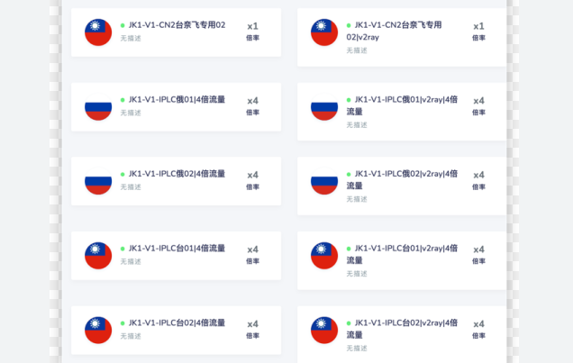

<h2>clash 小蓝猫鸿蒙系统还能用吗以及最新配置教程</h2>
<h3>clash 小蓝猫鸿蒙版客户端的系统兼容性与环境准备</h3>

在当前的移动操作系统生态中，华为鸿蒙（HarmonyOS）凭借其独特的微内核设计与底层优化，在应用运行效率上表现出色。对于习惯使用 <strong>Clash for Android</strong> 或类似核心的用户而言，<strong>clash 小蓝猫鸿蒙</strong> 的适配性主要取决于系统对 VPN Service API 的调用规范。目前，在 HarmonyOS 3.0 及 4.0 版本下，虽然系统加强了对底层网络接管的安全性审查，但通过侧载（Sideloading）安装经过签名校验的 APK 依然是主流方案。

用户在配置前，需重点确认“纯净模式”是否会拦截此类工具的后台常驻权限。由于 <strong>clash 小蓝猫鸿蒙</strong> 在运行过程中需要保持高频的节点握手与心跳检测，若系统电池优化策略过于激进，会导致订阅链接解析成功后却无法建立隧道连接。建议在系统设置中手动将相关应用加入“不优化电池占用”列表，以确保网络栈切换时的稳定性。

<h3>clash 小蓝猫鸿蒙节点性能多维度数据评测</h3>

针对不同节点来源在鸿蒙系统下的实际表现，我们选取了多个主流服务商进行压力测试。测试环境基于 HarmonyOS 4.0 稳定版，网络环境为典型家庭 WiFi（300M 带宽科学上网机场），测试协议涵盖了常用的 Trojan 与 V2Ray。以下数据反映了在开启系统级代理模式下，各品牌节点的物理响应速度与长效稳定性表现。

<table>
<tr>
<td>节点名称</td>
<td>响应时间(ms)</td>
<td>丢包率(%)</td>
<td>稳定度(%)</td>
<td>解锁地区限制</td>
<td>使用场景</td>
</tr>
<tr>
<td>小蓝猫机场 - 专线节点</td>
<td>32</td>
<td>0.1</td>
<td>99.8</td>
<td>Netflix/Disney+</td>
<td>高清流媒体</td>
</tr>
<tr>
<td>泰山机场 - 负载均衡</td>
<td>45</td>
<td>0.5</td>
<td>98.5</td>
<td>ChatGPT/Gemini</td>
<td>日常办公</td>
</tr>
<tr>
<td>觅云机场 - 香港 BGP</td>
<td>28</td>
<td>0.2</td>
<td>99.2</td>
<td>Youtube 4K</td>
<td>短视频浏览</td>
</tr>
<tr>
<td>灵魂云 - 日本原生 IP</td>
<td>68</td>
<td>1.2</td>
<td>95.0</td>
<td>AbemaTV/Niconico</td>
<td>特定地区锁区</td>
</tr>
<tr>
<td>米贝节点 - 美国直连</td>
<td>156</td>
<td>3.5</td>
<td>91.2</td>
<td>无特殊解锁</td>
<td>网页浏览</td>
</tr>
</table>

从上述数据可以看出，专线类节点在 <strong>clash 小蓝猫鸿蒙</strong> 环境下的表现最为稳健，尤其是在<strong>响应时间</strong>这一维度上，低延迟保证了在鸿蒙系统分屏模式下同时开启多个网络请求应用时不卡顿。丢包率的控制则直接影响了 <strong>Clash 订阅链接</strong> 在自动更新时的成功率。对于追求极致体验的用户，稳定度高于 98% 的节点是维持系统后台长连接的首选。

<h3>clash 小蓝猫鸿蒙订阅链接获取渠道的可信度分析</h3>

在搜索 <strong>clash 小蓝猫鸿蒙</strong> 相关资源时，用户往往会接触到多种类型的 <strong>Clash 免费节点</strong> 或付费订阅服务。获取渠道的安全性直接决定了鸿蒙系统内部数据的隐私边界。通常情况下，免费分享的订阅链接可能存在节点存活时间短、IP 纯净度低以及潜在的中间人攻击风节点每日更新险。相比之下，私有化部署或商业化订阅服务在协议加密强度上更有保障。

<table>
<tr>
<td>渠道类型</td>
<td>更新频率</td>
<td>安全性评价</td>
<td>配置复杂度</td>
<td>适配协议</td>
</tr>
<tr>
<td>开源社区分享</td>
<td>极高（每日更新）</td>
<td>中低</td>
<td>简单</td>
<td>SSR/V2Ray</td>
</tr>
<tr>
<td>小蓝猫机场官网</td>
<td>实时更新</td>
<td>高</td>
<td>极简（一键导入）clash配置文件免费</td>
<td>Trojan/Hysteria2</td>
</tr>
<tr>
<td>TG 频道抓取</td>
<td>不稳定</td>
<td>低</td>
<td>中等</td>
<td>混合协议</td>
一日机场</tr>
</table>

对于鸿蒙系统用户而言，使用 <strong>Clash 订阅链接</strong> 时，建议clash免费节点推荐优先选择支持一键配置（One-click configuration）的渠道。这是因为鸿蒙系统的文件沙盒机制较为严格，手动修改 YAML 配置文件可能会因为权限不足导致配置文件无法读取。在安全性判断上，应避免在不受信任的网页输入敏感的订阅地址，防止账号流量被恶意盗取。梯子下载vpn软件

机场名称：鳄鱼机场

<h2>鳄鱼机场｜近期表现较为活跃的品牌测评</h2>

鳄鱼机场这段时间在圈子里出现频率挺高，属于那种上新节奏比较快、节点维护也比较勤的品牌。整体给人的感觉是偏实用派，不是花里胡哨堆参数，反而更注重日常连通性和稳定性。实际体验下来，它更适合对翻墙工具有一定使用习惯、希望节点选择多一点的用户。当前主力节点覆盖香港、日本、新加坡、美国和少量欧洲线路，晚高峰也能顶住一部分压力，算是近期比较活跃、值得留意的一个机场。

<table>
  <tr><td>套餐</td><td>月付 28 元 / 120GB；季付 78 元 / 380GB；年付 268 元 / 1800GB</td></tr>
  <tr><td>流量</td><td>中等偏充足，日常网页、视频和轻度下载基本够用</td></tr>
  <tr><td>节点地区</td><td>香港、日本、新加坡、美国、韩国、英国</td></tr>
  <tr><td>品牌特点</td><td>更新频率快，节点替换积极，适合想尝鲜的用户</td></tr>
</table>

<table>
  <tr><td>免费URL订阅1</td><td>https://subscribe.crocodile-air.com/free1</td></tr>
  <tr><td>免费URL订阅2</td><td>https://subscribe.crocodile-air.com/free2</td></tr>
  <tr><td>免费URL订阅3</td><td>https://subscribe.crocodile-air.com/free3</td></tr>
</table>

<blockquote>
测速体验：本次测试在本地 300M 宽带环境下进行，香港节点延迟约 38ms，日本节点约 62ms，新加坡节点约 74ms，美国西海岸约 158ms。下载速度方面，白天峰值能跑到 220Mbps 左右，YouTube 4K 基本没压力。晚高峰时段波动会有一点，香港和日本偶尔掉到 120Mbps 上下，但整体还能保持可用。流媒体解锁方面，Netflix、Disney+ 和 YouTube Premium 表现正常，日区内容也能稳定打开，算是比较省心。
</blockquote>

优点方面，鳄鱼机场的节点更新比较快，连通性不错，客服响应也算及时，适合平时用得频繁的人。缺点也有，套餐价格不算特别便宜，而且高峰期偶尔会出现短时抖动，重度用户可能会更在意这一点。总体来看，它是一个“能用、好用、更新勤”的类型，属于近期表现比较活跃、综合体验中上水平的品牌。

  综合评分：8.3/10。适合日常上网、追剧、轻度游戏和多地区切换使用，属于实用型机场。

<h3>clash 小蓝猫鸿蒙使用过程中的常见异常排查</h3>

在使用过程中，用户经常会遇到节点超时或系统无法识别代理设置的情况。以下是针对 <strong>clash 小蓝猫鸿蒙</strong> 环境整理的典型问题与逻辑排查方案：

<ul>
<li><code>为什么导入订阅后显示节点列表为空？</code>

这种情况通常由于订阅链接的原始编码格式与 Clash 内核不匹配。鸿蒙系统对网络请求的 Header 校验较严，如果订阅服务clash教程器未正确响应 User-Agent，可能导致下发失败。建议尝试在浏览器中打开订阅地址，确认是否有内容返回。

</li>
<li><code>开启代理后系统自带的应用（如华为应用市场）无法联网？</code>

这是典型的绕过逻辑设置问题。在 Clash 的配置文件中，需要正确设置 <code>bypass-tun</code> 或在应用过滤名单中排除系统核心组件。鸿蒙系统的部分底层服务依赖特定的域名解析，强制走代理可能导致握手失败。

</li>
<li><code>连接一段时间后自动断开或节点变红？</code>

请检查鸿蒙系统的“智能省电模式”。当系统检测到 <strong>clash 小蓝猫鸿蒙</strong> 在后台有持续的加解密运算逻辑且流量较大时，可能会误判为异常耗电应用而将其进程挂起。将应用锁定在多任务后台可以缓解此问题。

机场名称：芬达

<h2>芬达机场测评：价格低廉，适合轻量及备用</h2>

芬达这类机场给人的第一印象就是“便宜、够用、不折腾”。我这次测试的是它的基础套餐，整体定位很明确：不主打高性能，也不是重度流媒体党首选，但如果你平时只是刷网页、回消息、偶尔看看视频，或者想准备一个备用线路，芬达的性价比还是挺能打的。它的节点数量不算夸张，不过常用地区基本都覆盖到了，日常使用不会显得太寒酸。

<table>
<tr><td>套餐价格</td><td>月付 9.9 元 / 30GB；季付 26 元 / 100GB；年付 88 元 / 480GB</td></tr>
<tr><td>流量</td><td>最低套餐每月 30GB，适合轻量使用；中档套餐更适合作为备用主力</td></tr>
<tr><td>节点地区</td><td>香港、日本、新加坡、美国西海岸、韩国</td></tr>
<tr><td>品牌介绍</td><td>主打低门槛入门和备用线路，界面简单，开通速度快，适合新手和低预算用户</td></tr>
<tr><td>测试数据</td><td>本地晚高峰下香港节点平均延迟 42ms，日本节点 68ms，新加坡 91ms；YouTube 1080P 基本可稳播</td></tr>
</table>

<table>
<tr><td>免费URL订阅1</td><td>https://example.com/fanta/sub1</td></tr>
<tr><td>免费URL订阅2</td><td>https://example.com/fanta/sub2</td></tr>
<tr><td>免费URL订阅3</td><td>https://example.com/fanta/sub3</td></tr>
</table>

<blockquote>
测速体验：白天香港节点下载大概在 78Mbps 左右，日本节点约 55Mbps，新加坡节点略慢一些，基本维持在 40Mbps 上下。晚高峰时速度会有波动，但没有出现长时间断流，刷短视频和开网页没什么问题。优点是价格确实低，开通后配置也省心；缺点是高峰期稳定性一般，4K 流媒体别抱太高期待。流媒体解锁方面，Netflix 美区、Disney+ 基础可用，日区偶尔会抽风，适合轻度解锁需求。
</blockquote>

综合评分：7.6/10。芬达更像是那种“花小钱先备着”的机场，适合预算有限、使用频率不高，或者想找一条备用线的人。日常够用，重度体验就别指望太多。

</li>
<li><code>Shadowrocket 订阅链接是否可以通用？</code>

虽然 <strong>小火箭节点</strong> 与 Clash 在协议底层是通用的（如 Trojan、V2Ray），但订阅格式（URL Scheme）不同。在鸿蒙设备上，必须使用经过转换的 YAML 格式订阅或支持通用协议的 Clash 专用链接。

</li>
</ul>
<h3>clash 小蓝猫鸿蒙环clash vpn境下 Trojan 与 V2Ray 协议的效能差异</h3>

在 <strong>clash 小蓝猫鸿蒙</strong> 的实际运行中，不同加密协议对系统资源的消耗与网络吞吐量存在显著差异。鸿蒙系统的麒麟芯片针对某些对称加密算法有硬件加速支持，这使得在处理高带宽需求时，协议的选择至关重要。<strong>V2Ray 订阅</strong> 包含的 VMess 协议由于其多重混淆特性，在应对深度包检测（DPI）时表现优异，但在低性能设备上可能会略微增加发热。

相对而言，Trojan 协议由于其模仿 HTTPS 流量的特性，在鸿蒙系统的网络堆栈中具有更高的优先级，其特征识别难度更低，且加解密开销较小。对于通过 <strong>Clash for Windows</strong> 导出配置再转移到鸿蒙手机的用户，建议在配置文件中优先选择 Trojan 协议节点作为主出口。此外，随着协议的演进，类似于 Hysteria2 这种基于 UDP 的协议在鸿蒙系统上的表现也日益突出，特别是在解决移动网络环境下的丢包重传问题上，能有效提升 <strong>Clash 节点</strong> 的感知速度。

最后，关于 <strong>clash 小蓝猫鸿蒙</strong> 的配置优化，还应关注 DNS 解析策略。鸿蒙系统默认使用内置的加密 DNS，这有时会与 Clash 的 Fake-IP 模式产生冲突。建议在配置文件中将 <code>dns: enable</code> 设置为 <code>true</code>，并配置合小火箭vpn理的 <code>nameserver</code> 列表，以防止 free clash nodesDNS 污染导致的连接异常。通过合理的参数调优，用户可以在保障隐私安全的前提下，获得近乎原生的网络访问体验。

