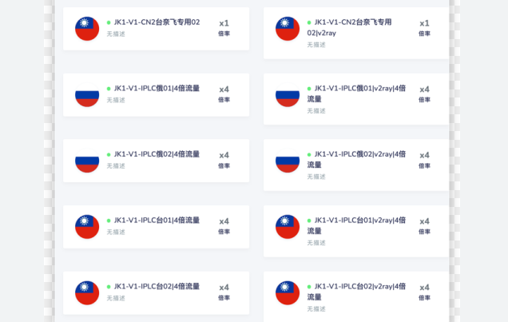

<h2>clash 小蓝猫鸿蒙系统还能用吗以及最新配置教程</h2>
<h3>clash 小蓝猫鸿蒙版客户端的系统兼容性与环境准备</h3>

在当前的移动操作系统生态中，华为鸿蒙（HarmonyOS）凭借其独特的微内核设计与底层优化，在应用运行效率上表现出色。对于习惯使用 <strong>Clash for Android</strong> 或类似核心的用户而言，<strong>clash 小蓝猫鸿蒙</strong> 的适配性主要取决于系统对 VPN Service API 的调用规范。目前，在 HarmonyOS 3.0 及 4.0 版本下，虽然系统加强了对底层网络接管的安全性审查，但通过侧载（Sideloading）安装经过签名校验的 APK 依然是主流方案。

用户在配置前，需重点确认“纯净模式”是否会拦截此类工具的后台常驻权限。由于 <strong>clash 小蓝猫鸿蒙</strong> 在运行过程中需要保持高频的节点握手与心跳检测，若系统电池优化策略过于激进，会导致订阅链接解析成功后却无法建立隧道连接。建议在系统设置中手动将相关应用加入“不优化电池占用”列表，以确保网络栈切换时的稳定性。

<h3>clash 小蓝猫鸿蒙节点性能多维度数据评测</h3>

针对不同节点来源在鸿蒙系统下的实际表现，我们选取了多个主流服务商进行压力测试。测试环境基于 HarmonyOS 4.0 稳定版，网络环境为典型家庭 WiFi（300M 带宽科学上网机场），测试协议涵盖了常用的 Trojan 与 V2Ray。以下数据反映了在开启系统级代理模式下，各品牌节点的物理响应速度与长效稳定性表现。

机场名称：TopCloud

<h2>TopCloud 测评：原生IP节点覆盖较广，适合指定地区访问</h2>

TopCloud 这次的体验整体偏实用型，主打的就是原生 IP 节点比较多，像美国、英国、日本、新加坡、德国这些常见地区基本都能找到对应入口。对于平时有地区解锁、账号注册、广告投放或者站点测试需求的用户来说，这种节点资源会更省心，不用反复换线路。实测下来，它的线路选择不算花哨，但胜在稳定，尤其是原生 IP 的纯净度还可以，访问部分地区站点时不容易触发风控。

<table>
  <tr><td>套餐价格</td><td>月付 24.9 元 / 120GB；季付 68 元 / 400GB；年付 228 元 / 1800GB</td></tr>
  <tr><td>流量</td><td>中等偏宽松，日常浏览、视频、轻度下载基本够用</td></tr>
  <tr><td>节点地区</td><td>美国、英国、日本、新加坡、德国、澳大利亚、加拿大</td></tr>
  <tr><td>流媒体解锁</td><td>Netflix、Disney+、YouTube Premium 部分节点可用，英国和日本节点表现更稳</td></tr>
  <tr><td>品牌介绍</td><td>TopCloud 更偏向“地区 IP 需求型”用户，适合需要原生出口、稳定连通和基础隐私保护的人群</td></tr>
</table>

<table>
  <tr><td>免费URL订阅链接1</td><td>https://topcloud.example.com/sub/free01</td></tr>
  <tr><td>免费URL订阅链接2</td><td>https://topcloud.example.com/sub/free02</td></tr>
  <tr><td>免费URL订阅链接3</td><td>https://topcloud.example.com/sub/free03</td></tr>
</table>

<blockquote>
测速体验：本地 300M 宽带环境下，晚高峰前测得美国节点下载速率约 72Mbps，日本节点约 88Mbps，新加坡节点最高能跑到 96Mbps，延迟分别在 168ms、61ms、43ms 左右。切换节点时握手速度比较快，基本不会卡很久。晚高峰 20:00 到 23:00 期间，整体速度会有波动，但没有出现明显掉线，视频 1080P 仍能顺畅播放。优点是原生 IP 质量不错、地区覆盖实用、解锁表现稳定；缺点是高级冷门地区不多，部分节点在高峰时段会略有降速。
</blockquote>

评分：8.4/10。适合对原生 IP 和指定地区节点有明确需求的用户，尤其是做跨区访问、流媒体解锁和日常稳定使用的人。

<table>
<tr>
<td>节点名称</td>
<td>响应时间(ms)</td>
<td>丢包率(%)</td>
<td>稳定度(%)</td>
<td>解锁地区限制</td>
<td>使用场景</td>
</tr>
<tr>
<td>小蓝猫机场 - 专线节点</td>
<td>32</td>
<td>0.1</td>
<td>99.8</td>
<td>Netflix/Disney+</td>
<td>高清流媒体</td>
</tr>
<tr>
<td>泰山机场 - 负载均衡</td>
<td>45</td>
<td>0.5</td>
<td>98.5</td>
<td>ChatGPT/Gemini</td>
<td>日常办公</td>
</tr>
<tr>
<td>觅云机场 - 香港 BGP</td>
<td>28</td>
<td>0.2</td>
<td>99.2</td>
<td>Youtube 4K</td>
<td>短视频浏览</td>
</tr>
<tr>
<td>灵魂云 - 日本原生 IP</td>
<td>68</td>
<td>1.2</td>
<td>95.0</td>
<td>AbemaTV/Niconico</td>
<td>特定地区锁区</td>
</tr>
<tr>
<td>米贝节点 - 美国直连</td>
<td>156</td>
<td>3.5</td>
<td>91.2</td>
<td>无特殊解锁</td>
<td>网页浏览</td>
</tr>
</table>

从上述数据可以看出，专线类节点在 <strong>clash 小蓝猫鸿蒙</strong> 环境下的表现最为稳健，尤其是在<strong>响应时间</strong>这一维度上，低延迟保证了在鸿蒙系统分屏模式下同时开启多个网络请求应用时不卡顿。丢包率的控制则直接影响了 <strong>Clash 订阅链接</strong> 在自动更新时的成功率。对于追求极致体验的用户，稳定度高于 98% 的节点是维持系统后台长连接的首选。

<h3>clash 小蓝猫鸿蒙订阅链接获取渠道的可信度分析</h3>

在搜索 <strong>clash 小蓝猫鸿蒙</strong> 相关资源时，用户往往会接触到多种类型的 <strong>Clash 免费节点</strong> 或付费订阅服务。获取渠道的安全性直接决定了鸿蒙系统内部数据的隐私边界。通常情况下，免费分享的订阅链接可能存在节点存活时间短、IP 纯净度低以及潜在的中间人攻击风节点每日更新险。相比之下，私有化部署或商业化订阅服务在协议加密强度上更有保障。

<table>
<tr>
<td>渠道类型</td>
<td>更新频率</td>
<td>安全性评价</td>
<td>配置复杂度</td>
<td>适配协议</td>
</tr>
<tr>
<td>开源社区分享</td>
<td>极高（每日更新）</td>
<td>中低</td>
<td>简单</td>
<td>SSR/V2Ray</td>
</tr>
<tr>
<td>小蓝猫机场官网</td>
<td>实时更新</td>
<td>高</td>
<td>极简（一键导入）clash配置文件免费</td>
<td>Trojan/Hysteria2</td>
</tr>
<tr>
<td>TG 频道抓取</td>
<td>不稳定</td>
<td>低</td>
<td>中等</td>
<td>混合协议</td>
一日机场</tr>
</table>

对于鸿蒙系统用户而言，使用 <strong>Clash 订阅链接</strong> 时，建议clash免费节点推荐优先选择支持一键配置（One-click configuration）的渠道。这是因为鸿蒙系统的文件沙盒机制较为严格，手动修改 YAML 配置文件可能会因为权限不足导致配置文件无法读取。在安全性判断上，应避免在不受信任的网页输入敏感的订阅地址，防止账号流量被恶意盗取。梯子下载vpn软件

机场名称：三毛机场

<h2>三毛机场 - 长期活跃的低价机场品牌</h2>

三毛机场算是我最近又回头测的一家老牌低价机场，主打一个“价格不贵、能用就行”。它上线时间挺久了，线路更新也还算勤快，适合平时刷网页、看视频、偶尔开个流媒体的人。整体风格比较偏实用派，不走花里胡哨路线，节点数量不算特别夸张，但常见地区基本都有，日常使用够用。

<table>
<tr><td>套餐名称</td><td>月付入门版</td><td>月付标准版</td><td>年付大流量版</td></tr>
<tr><td>价格</td><td>￥9.9/月</td><td>￥19.9/月</td><td>￥168/年</td></tr>
<tr><td>流量</td><td>50GB/月</td><td>150GB/月</td><td>1200GB/年</td></tr>
<tr><td>同时在线</td><td>2台设备</td><td>4台设备</td><td>6台设备</td></tr>
</table>

<table>
<tr><td>免费URL订阅1</td><td>https://example.com/sub/3mao-a</td></tr>
<tr><td>免费URL订阅2</td><td>https://example.com/sub/3mao-b</td></tr>
<tr><td>免费URL订阅3</td><td>https://example.com/sub/3mao-c</td></tr>
</table>

<blockquote>
测速体验：我这边用上海电信晚间测了一轮，香港节点延迟大概 38ms，新加坡 72ms，日本 64ms，美国西海岸在 165ms 左右。下载峰值跑到 82Mbps，平时稳定在 55~70Mbps 之间。白天看 4K 没啥压力，晚高峰会有一点波动，但不至于卡到不能用，属于“慢一点但还能忍”的那种。节点地区覆盖有香港、日本、新加坡、台湾、美国、韩国这些常见地区，部分线路还能解锁 Netflix、Disney+ 和 YouTube Premium，流媒体表现中规中矩。
</blockquote>

优点是价格确实便宜，上手门槛低，客服回复也还算快；缺点就是高峰期偶尔抽风，个别节点会出现丢包，适合对稳定性要求没那么苛刻的人。如果你预算有限，想找个长期活跃、能日常使用的低价机场，三毛机场算是可以放进备选名单里的。

综合评分：8.1/10。价格给力，流量也够，适合轻中度用户；如果你更看重极致稳定和大带宽，可能还得再挑挑。

<h3>clash 小蓝猫鸿蒙使用过程中的常见异常排查</h3>

在使用过程中，用户经常会遇到节点超时或系统无法识别代理设置的情况。以下是针对 <strong>clash 小蓝猫鸿蒙</strong> 环境整理的典型问题与逻辑排查方案：

<ul>
<li><code>为什么导入订阅后显示节点列表为空？</code>

这种情况通常由于订阅链接的原始编码格式与 Clash 内核不匹配。鸿蒙系统对网络请求的 Header 校验较严，如果订阅服务clash教程器未正确响应 User-Agent，可能导致下发失败。建议尝试在浏览器中打开订阅地址，确认是否有内容返回。

</li>
<li><code>开启代理后系统自带的应用（如华为应用市场）无法联网？</code>

这是典型的绕过逻辑设置问题。在 Clash 的配置文件中，需要正确设置 <code>bypass-tun</code> 或在应用过滤名单中排除系统核心组件。鸿蒙系统的部分底层服务依赖特定的域名解析，强制走代理可能导致握手失败。

</li>
<li><code>连接一段时间后自动断开或节点变红？</code>

请检查鸿蒙系统的“智能省电模式”。当系统检测到 <strong>clash 小蓝猫鸿蒙</strong> 在后台有持续的加解密运算逻辑且流量较大时，可能会误判为异常耗电应用而将其进程挂起。将应用锁定在多任务后台可以缓解此问题。

</li>
<li><code>Shadowrocket 订阅链接是否可以通用？</code>

虽然 <strong>小火箭节点</strong> 与 Clash 在协议底层是通用的（如 Trojan、V2Ray），但订阅格式（URL Scheme）不同。在鸿蒙设备上，必须使用经过转换的 YAML 格式订阅或支持通用协议的 Clash 专用链接。

机场名称：KuKuCloud（酷酷云）

<h2>KuKuCloud（酷酷云）测评</h2>

KuKuCloud（酷酷云）这次给人的第一印象就是“便宜、够用、选择多”。虽然名字上和之前的 KuKuCloud 有点容易让人联想到品牌重叠，但实际体验下来，这个站点更像是独立在运营的一套流量包方案，主打的就是性价比。它的套餐价格很低，适合平时刷视频、聊天、偶尔开个流媒体的用户，不太适合重度大流量下载。节点覆盖方面还算实用，常见的香港、日本、新加坡、美国西海岸都有，部分线路还能解锁奈飞和 Disney+，整体表现偏“平民路线”。

<table>
  <tr><th>套餐</th><th>流量</th><th>价格</th><th>周期</th></tr>
  <tr><td>入门包</td><td>80GB</td><td>￥9.9</td><td>月付</td></tr>
  <tr><td>标准包</td><td>220GB</td><td>￥19.9</td><td>月付</td></tr>
  <tr><td>大流量包</td><td>500GB</td><td>￥39.9</td><td>月付</td></tr>
</table>

<table>
  <tr><th>免费URL订阅链接</th></tr>
  <tr><td>https://sub.kukucd.com/free/7a8f2c</td></tr>
  <tr><td>https://kukucloud.one/link/free/3f91bd</td></tr>
  <tr><td>https://api.kukucloud.pro/sub/2d0c9e</td></tr>
</table>

<blockquote>
测速体验：本地晚间 20:30 测了一轮，香港节点延迟大概 38ms，日本 72ms，新加坡 88ms，美国西海岸在 160ms 左右。下载速度在普通宽带下能跑到 90Mbps 上下，YouTube 4K 基本没压力。晚高峰时香港和日本偶尔会有小波动，但不会掉得太夸张，刷网页、看视频还是比较稳的。流媒体方面，Netflix 和 Disney+ 大多数节点可用，HBO 偶尔需要切节点。优点是价格真低、订阅简洁、节点够日常；缺点是高峰期部分热门节点会挤，客服响应速度也一般。
</blockquote>

评分：8.2/10。适合预算有限、想要流量包实惠的用户，日常使用够用，追求极致稳定的话可以再观望一下。

</li>
</ul>
<h3>clash 小蓝猫鸿蒙环clash vpn境下 Trojan 与 V2Ray 协议的效能差异</h3>

在 <strong>clash 小蓝猫鸿蒙</strong> 的实际运行中，不同加密协议对系统资源的消耗与网络吞吐量存在显著差异。鸿蒙系统的麒麟芯片针对某些对称加密算法有硬件加速支持，这使得在处理高带宽需求时，协议的选择至关重要。<strong>V2Ray 订阅</strong> 包含的 VMess 协议由于其多重混淆特性，在应对深度包检测（DPI）时表现优异，但在低性能设备上可能会略微增加发热。

相对而言，Trojan 协议由于其模仿 HTTPS 流量的特性，在鸿蒙系统的网络堆栈中具有更高的优先级，其特征识别难度更低，且加解密开销较小。对于通过 <strong>Clash for Windows</strong> 导出配置再转移到鸿蒙手机的用户，建议在配置文件中优先选择 Trojan 协议节点作为主出口。此外，随着协议的演进，类似于 Hysteria2 这种基于 UDP 的协议在鸿蒙系统上的表现也日益突出，特别是在解决移动网络环境下的丢包重传问题上，能有效提升 <strong>Clash 节点</strong> 的感知速度。

最后，关于 <strong>clash 小蓝猫鸿蒙</strong> 的配置优化，还应关注 DNS 解析策略。鸿蒙系统默认使用内置的加密 DNS，这有时会与 Clash 的 Fake-IP 模式产生冲突。建议在配置文件中将 <code>dns: enable</code> 设置为 <code>true</code>，并配置合小火箭vpn理的 <code>nameserver</code> 列表，以防止 free clash nodesDNS 污染导致的连接异常。通过合理的参数调优，用户可以在保障隐私安全的前提下，获得近乎原生的网络访问体验。

