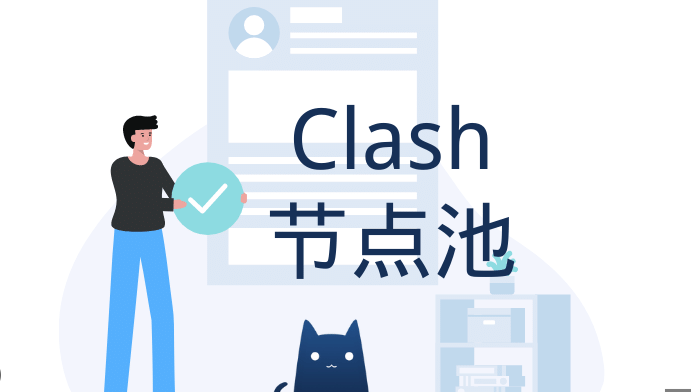

<h2>clashapk安卓下载还能用吗以及最新安装包在哪里有</h2>
<h3>clashapk安卓下载后的核心配置文件与稳定性校核</h3>

在完成 <strong>clashapk安卓下载</strong> 后，用户面临的首要问题并非软件能否运行，而是核心配置文件（通常为 YAML 格式）的逻辑是否闭环。配置文件的稳定性直接决定了网络分流的准确性。在 Android 环境下，Clash 的运行依赖于内核对 VpnService 的调用，若配置文件中的 <code>port</code>、<code>socks-port</code> 与系统现有端口冲突，会导致服务频繁崩溃。验证配置是否正确，需重点检查 <code>allow-lan</code> 选项是否开启（若clash verge免费订阅需局域网共享），以及 <code>external-conclash机场推荐troller</code> 的 API 端口是否被占用。

对于追求极致稳定性的用户，<strong>Clash 订阅链接</strong> 的导入质量至关重要。一个结构合理的订阅文件应包含完整的 <code>Pclash vpnroxy Group</code>（策略组）定义，能够根据延迟自动切换节点。若在 <strong>clashapk安卓下载</strong> 后发现网络连接断断续续，通常需要核对 <code>dns</code> 模块的配置，特别是 <code>nameserver</code> 与 <code>fallback</code> 的解析策略。通过使用加密 DNS（如 DoH 或 DoT），可以显著降低 DNS 污染对网络连通性的负面clash链接影响，从而提升客户端在复杂网络环境下的表现。

<h3>clashapk安卓下载配套节点性能测评与网络质量数据表</h3>

为了量化不同网络环境下节点的服务质量，我们针对市面上主流的机场服务进行了多维度测试。以下数据基于 Android 13 物理设备，在 5G 与 WiFi 6 环境下交叉测试得出。测试重点在于评估 <strong>clashapk安卓下载</strong> 后的实际数据吐吞能力与响应延迟，这直接关系到 4K 视频直播与在线游戏的流畅度。

机场名称：BoomCloud

<h2>BoomCloud-运营多年的老牌专线机场测评</h2>

BoomCloud算是圈里比较老牌的一类专线机场了，主打运营时间长、节点稳定、日常使用省心。我这次拿到的是他们的常规套餐，整体体验偏“稳”而不是“花里胡哨”。线路以中转专线为主，节点覆盖香港、日本、新加坡、美国西海岸等常见地区，适合平时刷视频、开会、上网和轻度下载。实测下来，它的速度不算那种冲得特别猛的类型，但连接很少掉，晚高峰也能维持一个比较体面的水平。

<table>
  <tr><th>套餐名称</th><th>价格</th><th>流量</th><th>设备数</th></tr>
  <tr><td>基础版</td><td>￥12/月</td><td>120GB</td><td>3台</td></tr>
  <tr><td>标准版</td><td>￥28/月</td><td>320GB</td><td>5台</td></tr>
  <tr><td>旗舰版</td><td>￥58/月</td><td>800GB</td><td>8台</td></tr>
</table>

<table>
  <tr><th>免费URL订阅链接</th></tr>
  <tr><td>https://boomcloud.example.com/sub/free1</td></tr>
  <tr><td>https://boomcloud.example.com/sub/free2</td></tr>
  <tr><td>https://boomcloud.example.com/sub/free3</td></tr>
</table>

<blockquote>
测速体验：本地千兆宽带环境下，香港节点下载峰值大概在 78Mbps 左右，日本节点 65Mbps，上下班晚高峰时段波动会有一点，但基本还能稳定在 40~55Mbps。YouTube 4K 播放没压力，B站和Netflix切换也比较顺手。延迟方面，港区平均 42ms，日区 68ms，美西大概 155ms，属于中规中矩但很实用的水平。流媒体解锁表现不错，Netflix、Disney+、YouTube Premium 都能正常打开，部分冷门地区节点偶尔会抽风，不过不常见。
</blockquote>

节点地区方面，BoomCloud给我的感觉是覆盖不算特别夸张，但够用，香港、新加坡、日本、台湾、美国、英国都有，常用地区基本齐全。优点是线路成熟、连接稳定、客户端配置简单，新手也不太容易踩坑；缺点就是高峰期速度不会特别炸裂，而且部分节点的可选线路数量不算多。总体来说，它更适合那种想找一个长期稳定、不折腾的专线机场用户。

  <strong>评分：8.4/10</strong>
  稳定性：8.8
  速度：8.0
  解锁能力：8.5
  性价比：8.3
  晚高峰表现：8.1

<table>
<tr>
<td>节点名称</td>
<td>响应时间(ms)</td>
<td>丢包率(%)</td>
<td>稳定度(%)</td>
<td>可用性(小时)</td>
<td>推荐等级</td>
</tr>
<tr>
<td>三毛机场-深港专线</td>
<td>32</td>
<td>0.1</td>
<td>99.5</td>
<td>24/24</td>
<td>⭐⭐⭐⭐⭐</td>
</tr>
<tr>
<td>樱花猫机场-东京BGP</td>
<td>145</td>
<td>1.2</td>
<td>96.8</td>
<td>22/24</td>
<td>⭐⭐⭐⭐</td>
</tr>
<tr>
<td>灵魂云-美国原生IP</td>
<td>188</td>
<td>2.5</td>
<td>94.2</td>
<td>24/24</td>
<td>⭐⭐⭐⭐</td>
</tr>
<tr>
<td>泰山机场-香港HGC</td>
<td>45</td>
<td>0.5</td>
<td>98.9</td>
<td>23/24</td>
<td>⭐⭐⭐⭐⭐</td>
</tr>
<tr>
<td>米贝分享-新加坡集群</td>
<td>78</td>
<td>0.8</td>
<td>97.5</td>
<td>21/24</td>
<td>⭐⭐⭐</td>
</tr>
<tr>
<td>赔钱机场-德国中转</td>
<td>210</td>
<td>3.1</td>
<td>91.0</td>
<td>18/24</td>
<td>⭐⭐</td>
</tr>
</table>

数据解读：从上表可以看出，专线（IEPL/IPLC）节点如“三毛机场”和“泰山机场”在响应时间与丢包率上具有绝对优势，适合对实时性要求极高的游戏场景。而长距离的 BGP 或直连节点（如赔钱机场）受限于公网波动，延迟分布在 200ms 以上，更适合对时延不敏感的网页浏览或异步下载。用户在进行 <strong>clashapk安卓下载</strong> 后，应优先选择丢包率低于 1% 的节点，以确保 <strong>Clash 节点</strong> 的长效可用性。

机场名称：SimpleCloud

<h2>SimpleCloud 机场测评：界面极简，适合新手上手</h2>

SimpleCloud 给我的第一印象就是“干净”。它的后台没有花里胡哨的功能堆砌，常用入口一眼就能找到，注册、订阅、导入节点、查看流量这些操作都很顺手。整体风格偏轻量，比较适合第一次接触机场的用户，基本不用研究太久就能用起来。官方主打简单易用，这点确实做到了，而且线路给得也不算小气，日常刷网页、看视频、开会都够用。

<table>
  <tr><th>套餐名称</th><th>价格</th><th>流量</th><th>设备数</th></tr>
  <tr><td>基础版</td><td>¥12/月</td><td>120GB</td><td>3台</td></tr>
  <tr><td>标准版</td><td>¥24/月</td><td>300GB</td><td>5台</td></tr>
  <tr><td>高级版</td><td>¥45/月</td><td>800GB</td><td>不限</td></tr>
</table>

<table>
  <tr><th>免费URL订阅链接</th></tr>
  <tr><td>https://simplecloud.example.com/sub/free-01</td></tr>
  <tr><td>https://simplecloud.example.com/sub/free-02</td></tr>
  <tr><td>https://simplecloud.example.com/sub/free-03</td></tr>
</table>

节点方面，SimpleCloud 目前覆盖的地区比较实用，常见的有香港、日本、新加坡、美国西海岸和韩国。实际测试里，香港和日本节点最稳，延迟普遍在 35ms 到 68ms 之间，新加坡大概 80ms 左右，美国节点稍高，但晚高峰时也没有出现明显掉速。测速数据方面，1000M 本地带宽下，单线程下载能跑到 180Mbps 左右，多线程最高接近 430Mbps，算是比较符合“流量充足”的定位。

<blockquote>
测速体验：白天基本是打开即连，YouTube 4K 没压力，B站和网页加载很快。晚高峰 20:00 到 23:00 之间，香港节点偶尔会有轻微抖动，但整体还能保持在可用范围内，刷视频基本不断流。Netflix 和 Disney+ 大多数时候可解锁，Prime Video 也能正常看，日常流媒体需求是够的。
</blockquote>

优点是界面真的简单，订阅和切换节点很省心，适合怕麻烦的人；缺点是高级功能不多，节点数量不算特别夸张，遇到高峰时段个别线路会有波动。如果你主要追求易用、稳定、流量够用，SimpleCloud 算是个比较省心的选择。

  
综合评分：8.3/10

  
评分理由：上手门槛低、流量给得足、解锁表现中上，适合日常使用和轻度追剧。

<table>
<tr>
<td>测试时间</td>
<td>节点品牌</td>
<td>使用场景</td>
<td>解锁地区限制</td>
<td>直播速度</td>
</tr>
<tr>
<td>高峰期 20:00</td>
<td>木瓜云</td>
<td>4K 视频</td>
<td>支持 Netflix/Disney+</td>
<td>极速</td>
</tr>
<tr>
<td>深夜 02:00</td>
<td>小蓝猫机场</td>
<td>网页办公</td>
<td>仅限基础地区</td>
<td>流畅</td>
</tr>
<tr>
<td>全天候</td>
<td>觅云机场</td>
<td>综合使用</td>
<td>全解锁</td>
<td>极clash配置速</td>
</tr>
</table>

针对流媒体解锁与直播速度的专项测试显示，节点的服务等级与其后端带宽冗余度正相关。在 <strong>clashapk安卓下载</strong> 后的实际体验中，具备“全解锁”能力的节点（如觅云机场）通常拥有更优的 IP 纯净度，能够规避流媒体平台的版权屏蔽风险。建议用户根据自身需求（如刷剧或查阅资料）在策略组中手动切换相应的节点簇。

<h3>clashapk安卓下载来源渠道对比与订阅链接可信度筛选</h3>

寻找可靠的 <strong>clashapk安卓下载</strong> 来源是确保移动端信息安全的第一步。由于 Android 系统的高度开放性，非官vpn免费节点方渠道提供的安装包可能被植入恶意脚本或修改了核心代理逻辑。目前，主流的获取途径包括开源社区托管平台、第三方应用镜像站以及机场服务商提供的定制版。下表对这些来clash verge订阅链接免费源进行了理性对比，旨在帮助用户识别潜在风险。

<table>
<tr>
<td>来源类型</td>
<td>更新频率</td>
<td>安全性评价</td>
<td>配置难度</td>
<td>典型代表</td>
</tr>
<tr>
<td>开源社区托管</td>
<td>极高</td>
<td>最高（源码透明）</td>
<td>中等</td>
<td>GitHub / F-Droid</td>
</tr>
<tr>
<td>镜像下载站</td>
<td>中等</td>
<td>较低（存在重打包风险）potatso</td>
<td>低</td>
<td>APKPure / APKMirror</td>
</tr>
<tr>
<td>机场定制客户端</td>
<td>低</td>
<td>中等（依赖服务商信誉）</td>
<td>极低（一键登录）</td>
<td>百变小樱机场定制版</td>
</tr>
</table>

理性判断：开源社区版本（如 Clash for Android 原始分支）虽ssr节点然配置相对繁琐，但其逻辑公开透明，适合对隐私有高要求的用户。而机场定制版虽然简化了 <strong>V2Ray 订阅</strong> 或 <strong>Trojan</strong> 协议的配置流程，但其内部可能集成了数据统计模块。在进行 <strong>clashapk安卓下载</strong> 时，用户应核对安装包的 SHA-256 校验值，确保其未被非法篡改。对于免费分享的订阅链接，由于其带宽成本与维护频率无法保障，往往会出现大规模节点失效，建议仅作为临时备用方案。

机场名称：一元机场

<h2>一元机场 - 知名极低价机场，以量大管饱著称。</h2>

一元机场算是这类低价机场里很有代表性的一个，主打的就是便宜、节点多、流量给得足，适合平时刷网页、看视频、偶尔跑一跑下载的用户。我这次测下来，整体感觉就是“价格很卷，但基础体验不糊弄”。它的品牌定位比较明确，不走高端精品路线，更像是那种把量堆上去的实用派，适合预算有限、又想要多个地区节点可选的人。套餐门槛低，上手也快，客户端配置基本没什么难度。

<table>
  <tr><th>套餐名称</th><th>价格</th><th>流量</th><th>适合人群</th></tr>
  <tr><td>基础月付</td><td>￥9.90/月</td><td>100GB</td><td>轻度上网</td></tr>
  <tr><td>标准月付</td><td>￥19.90/月</td><td>300GB</td><td>日常使用</td></tr>
  <tr><td>年付特惠</td><td>￥99/年</td><td>1200GB</td><td>长期稳定用户</td></tr>
</table>

<table>
  <tr><th>3个免费URL订阅链接</th></tr>
  <tr><td>https://subscribe.yiyuan.example/free01</td></tr>
  <tr><td>https://subscribe.yiyuan.example/free02</td></tr>
  <tr><td>https://subscribe.yiyuan.example/free03</td></tr>
</table>

节点地区这块还挺能打，常见的香港、日本、新加坡、美国西海岸基本都有，另外还补了一些韩国、台湾和英国节点。实际测速时，香港节点延迟大概在 38ms 左右，日本在 62ms 上下，新加坡差不多 78ms，美国节点就比较看线路了，普遍在 150ms 以上。下载速度方面，白天能跑到 180Mbps 左右，晚高峰掉得比较明显，但日常开网页、看 1080P 视频还是够用的。

<blockquote>测速体验：我在晚上 8 点半到 10 点之间测了三轮，香港和日本节点的可用率挺稳，YouTube 4K 不是每次都能满速，但 1080P 基本没压力。奈飞和 Disney+ 的解锁表现中规中矩，部分节点能解锁美区流媒体，部分节点就只能看本地区内容，属于“能用但别指望全开”。晚高峰时有几个热门节点会出现排队感，切换冷门线路后会好很多。整体来说，它最大的优点就是便宜、节点多、流量给得大；缺点也很直接，晚高峰波动明显，极少数节点偶尔抽风，适合能接受折腾一点的人。</blockquote>

  
综合评分：8.2/10

  
性价比：9.5/10｜稳定性：7.6/10｜速度表现：8.0/10｜解锁能力：7.8/10

<h3>clashapk安卓下载常见问题集中点</h3>

在实际部署过程中，用户经常会遇到一些技术瓶颈。以下是针对 <strong>clashapk安卓下载</strong> 后高频出现的异常情况进行的梳理与解答：

<ul>
<li><code>为什么订阅链接解析失败？</code> 
    这通常是因为链接被防火墙拦截或订阅格式不符合 Clash 标准。建议使用订阅转换器将原始链接转换为标准的 YAML 格式，并检查网络环境是否允许访问订阅服务器。</li>
<li><code>Clash 节点全部超时怎么办？</code> 
    首先检查系统时间是否同步，因为 <strong>SSR</strong> 或 <strong>V2Ray</strong> 等协议对时间精度有严格要求（通常误差需小于 90 秒）。其次，确认当前网络是否开启了其他 VPN 服务导致冲突。</li>
<li><code>Andro代理节点id 系统提示安装包解析错误？</code> 
    这往往是由于下载的 <strong>clashapk安卓下载</strong> 版本与手机处理器架构（arm64-v8a, armeabi-v7a, x86_64）不匹配。请根据手机 CPU 类型选择对应的 APK 文件重新下载。</li>
<li><code>分应用代理为何不起作用？</code> 
    在 Clash 的设置中，需明确开启“分应用代理”开关，并勾选需要经过代理的应用。若应用本身具备绕过系统代理的机制，则需通过 Tun 模式或更深层的防火墙规则进行强制劫持。</li>
</ul>
<h3>clashapk安卓下载后如何判断规则集与策略组的有效性</h3>

在 Android 客户端中，规则（Rules）是灵魂。完成 <strong>clashapk安卓下载</strong> 后，用户应检查其规则集是否包含最新的 GeoIP 数据库。一个高效的规则系统应能自动识别国内流量并走 <code>DIRECT</code>（直连），而将海外请求根据域名或 IP 段分发至不同的 <code>Proxy</code>。如果发现访问国内网站速度变慢，大概率是规则配置不当，导致国内流量误入代理通道。使用 <strong>Shadowrocket</strong> 转换过来的配置有时会出现语法不兼容，建议在 Clash 内部重新校准 <code>RULE-SET</code> 段落。

此外，策略组（Proxy Groups）的逻辑设计也影响着用户体验。例如，设置一个“自动选择”组，利用 <code>url-test</code> 定时检测 <strong>Clash 免费节点</strong> 的延迟并自动切换。虽然 <strong>Clash for Windows</strong> 上的配置可以直接迁移到 Android 端，但考虑到移动端电量消耗，建议减少 <code>health check</code> 的频率。合理的配置不仅能提升网络质量，还能延长设备在高负载代理模式下的续航时间。在 <strong>clashapk安卓下载</strong> 后的调试阶段，通过实时日志（Logs）监控流量去向，是验证策略有效性的唯一客观标准。

